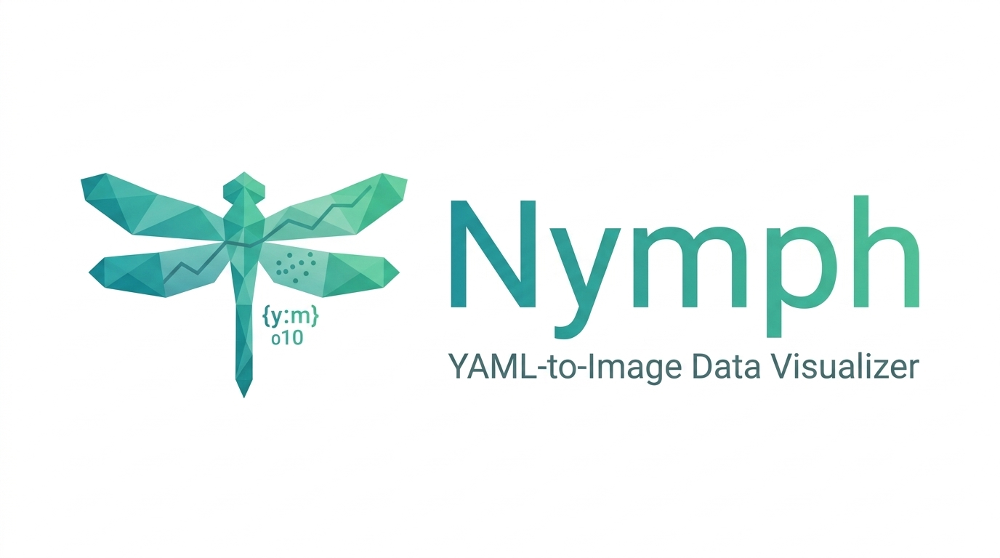
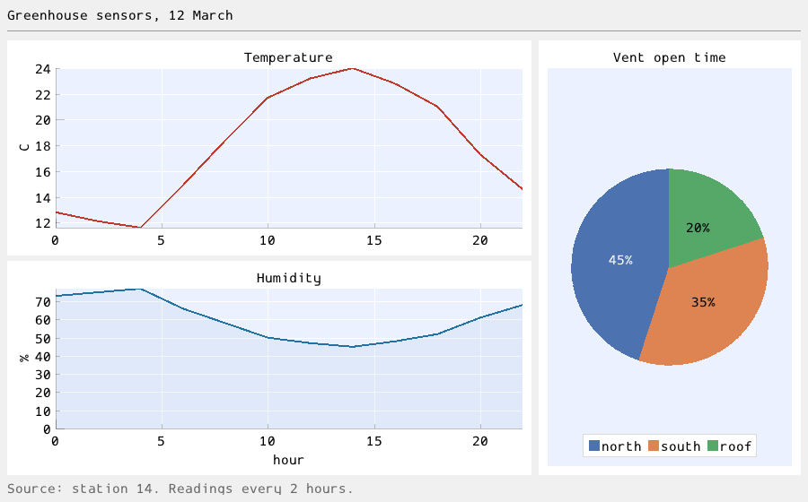

nymph is a command-line tool that turns a YAML file describing a chart
into a PNG image, and a nymph PNG back into its YAML (the YAML is stored
inside the image). It draws 2D and 3D plots, UML diagrams, flowcharts,
Gantt and Sankey charts, user-interface mockups, labels and layouts
with Dear ImGui, ImPlot, ImPlot3D and ImUml (nymph's own UML library for
ImGui), and rasterizes them with
OpenGL when a GPU is available, or on the CPU with its own software
rasterizer: no GPU, window or display needed, and no OpenGL library
linked.
It is meant for AI agents that need to show information as a chart.
The [web viewer](docs/viewer.md) ([live demo](https://binary-dice-games.github.io/nymph/demo/))
shows the same charts live in a web page
(WebAssembly and WebGL2), with pan, zoom and data-point values, for
markdown viewers and chatbots: `<nymph-viewer src="chart.yaml"></nymph-viewer>`;
`nymph view chart.yaml` opens it in a window; `--edit` adds a panel and a
floating toolbar to click-select texts and elements and edit them, add and
remove elements,
edit the data tables, and let an AI agent work on the open chart through
`nymph mcp`.
The [Chrome extension](docs/extension.md) does it on any page you read:
nymph PNGs on GitHub or any site become live charts of the same size.

It started as wish's `nymph` module and is now standalone, with no wish or
bison dependency (and no compatibility with wish's format). **Status:**
verified on Linux. CI builds and tests Linux, macOS and Windows (MSVC,
MSYS2) on every pull request and a tag push publishes a release
([docs/releasing.md](docs/releasing.md)); macOS and Windows have not yet
passed there ([spec/07_release_pipeline](spec/07_release_pipeline/PLAN.md)).



AI agents: start with [docs/agent-guide.md](docs/agent-guide.md). Claude uses
nymph through `nymph mcp`, an MCP server whose charts show live in the
conversation: in Claude Code,
`/plugin install nymph --marketplace binary-dice-games/nymph`; Claude
Desktop and claude.ai in [docs/claude.md](docs/claude.md); Cursor in
[docs/cursor.md](docs/cursor.md).

## Install

From a published release:

```sh
brew install binary-dice-games/nymph/nymph       # macOS, Linux (Homebrew)
curl -fsSL https://github.com/binary-dice-games/nymph/releases/latest/download/install.sh | sh
irm https://github.com/binary-dice-games/nymph/releases/latest/download/install.ps1 | iex   # Windows
winget install BinaryDiceGames.Nymph             # Windows (winget)
```

The scripts install the release executable for your system (checked
against the release's SHA-256 sums) and put it on your `PATH`. Where
third-party binaries are not allowed, build the release's
`nymph-<version>-src.tar.gz`, which carries every dependency and builds
offline ([docs/building.md](docs/building.md#from-the-source-tarball)).

## Quick Build

```sh
cmake -S . -B build
cmake --build build
ctest --test-dir build
cmake --install build      # puts nymph on your PATH
```

See [docs/building.md](docs/building.md) for prerequisites, CMake options,
and platform notes.

## Quick Start

```sh
cat > chart.yaml <<'YAML'
root:
  type: Plot
  title: Revenue
  children:
    - {type: PlotLine, label: revenue, ys: $revenue}
data: {revenue: [12, 15, 11, 18]}
YAML
nymph chart.yaml        # writes chart.png (no display or GPU needed)
nymph chart.yaml --rasterizer software   # always the CPU: same bytes on every machine
nymph chart.png         # prints the YAML back
```

The YAML travels inside the PNG only while the file is copied byte for
byte: services that re-encode images drop it, so keep the YAML too.

See [docs/cli.md](docs/cli.md) for every command,
[docs/format.md](docs/format.md) for the format and
[docs/examples.md](docs/examples.md) for more charts. As a library:

```cpp
#include <nymph.hpp>
#include <fstream>

int main() {
  const char* source =
      "root:\n"
      "  type: Plot\n"
      "  title: Revenue\n"
      "  children:\n"
      "    - {type: PlotLine, label: revenue, ys: $revenue}\n"
      "data: {revenue: [12, 15, 11, 18]}\n";
  const std::vector<uint8_t> png = bdg::nymph::render_png(source); // throws bdg::nymph::error
  std::ofstream("chart.png", std::ios::binary).write((const char*)png.data(), png.size());
}
```

Link against the `nymph` CMake target (`nymph::nymph` alias). The PNG
carries its source: `bdg::nymph::extract_source(png)` returns it.

## Project Layout

| Path | Contents |
|------|----------|
| `src/` | The `nymph` library (namespace `bdg::nymph`) |
| `imuml/` | ImUml, the UML diagram library for Dear ImGui that nymph's diagrams use |
| `app/` | The `nymph` command-line executable |
| `tests/` | GoogleTest suite, run with `ctest` |
| `web/` | The interactive web viewer: WebAssembly module and JavaScript API (`NYMPH_WEB`) |
| `claude/` | Claude integration: the agent skill text (`claude/skill/`), the MCP App that shows charts live in the chat (`claude/app/`) and the Claude Code plugin (`claude/plugin/`, listed by `.claude-plugin/marketplace.json`) |
| `cursor/` | Cursor integration: the plugin (`cursor/plugin/`, listed by `.cursor-plugin/marketplace.json`) and its rule template |
| `extension/` | The Chrome extension that turns nymph PNGs on any page into live viewers (built with `NYMPH_WEB`) |
| `examples/` | Example sources and the PNGs rendered from them |
| `resources/` | Project assets: the logo, the app icon (`icon.png`: `nymph view`'s window, the MCP bundle; `icon.ico`: `nymph.exe`), and the fonts (Google Fonts, OFL) and placeholder images compiled into the binary (`fonts/`, `placeholders/`) |
| `cmake/` | CMake helper modules |
| `docs/` | Detailed documentation |
| `spec/` | Design and plan of each project, one numbered folder per project ([INDEX.md](spec/INDEX.md)) |
| `packaging/` | Install scripts (`install.sh`, `install.ps1`), the Homebrew formula and winget manifest templates and the Chrome Web Store upload |
| `.github/` | CI and release workflows and their scripts |
| `extern/` | Third-party dependencies (git submodules) |

## Core Concepts

| Concept | Description |
|---------|-------------|
| **Source** | One YAML document: `description`, `image` options, a `root` element tree, `data`, and optional `source`. |
| **UML diagrams and flowcharts** | `ClassDiagram`, `SequenceDiagram`, `StateDiagram`, `ActivityDiagram`, `UseCaseDiagram`, `ERDiagram` (database tables), `DataFlowDiagram`, `NetworkDiagram`, `ComponentDiagram`, `DeploymentDiagram`, `PackageDiagram`, `ObjectDiagram` and `Flowchart`, plus `TreeDiagram`, `MindMap` and `OrgChart` (hierarchies written by nesting; `Shape` and `nymph shapes` for the shape library) (any node-and-link diagram, with groups): nodes and edges named by `id`, laid out automatically (Graphviz dot-style). See [docs/format.md](docs/format.md#uml-diagrams). |
| **Elements** | `Plot` / `Plot3D` and their series (lines, bars, grouped bars, error bars, heatmaps, annotations, ...; log, time and category axes), `GanttChart` (schedules), `SankeyDiagram` (flows), `ColorScale`, plus `VerticalLayout` / `HorizontalLayout`, `Spring`, `Label` and separators to combine them. New types register a class; see [the design](spec/01_core_features/DESIGN.md#9-extension-points). |
| **User interfaces** | A `Screen` of Dear ImGui `Window`s holding ImGui widgets by their ImGui names (`Button`, `SliderFloat`, `TreeNode`, `Table`, menus, popups), built-in placeholder `Image`s and `WindowTransition` arrows for the UI flow: a mockup in a PNG, usable in the viewers. See [docs/format.md](docs/format.md#user-interfaces). |
| **Data** | `data` holds one table, or several named tables, as CSV text or columns. |
| **Column references** | `$name` / `$2` in a field takes data from a column; `$table:name` from a named table. |
| **Text style** | `font` (an embedded font by file name), `font_size` and `text_color` on `image`, layouts, plots and labels, inherited down the tree. `nymph fonts` lists the fonts. |
| **Provenance** | An optional `source` key records the prompt, query or code that made the data; it travels in the PNG for the next edit. |
| **Round trip** | The PNG carries its YAML; `nymph image.png` prints it back byte for byte. |
| **Rasterizers** | `--rasterizer opengl` (CLI default: the GPU, loaded at run time, falling back silently) or `software` (byte-exact, the library default). `nymph rasterizers` says what this machine can use. |

## Further Documentation

| File | Contents |
|------|----------|
| [docs/building.md](docs/building.md) | Prerequisites, CMake options, build commands |
| [docs/cli.md](docs/cli.md) | The `nymph` command: render, extract, check, schema, exit codes, errors |
| [docs/format.md](docs/format.md) | The YAML source format: keys, field values, layout, data, column references |
| [docs/elements.md](docs/elements.md) | Element reference, in pages: this root lists them, `docs/elements/<Type>.md` has the fields (generated by `nymph schema --markdown --paged`) |
| [docs/agent-guide.md](docs/agent-guide.md) | Self-contained instructions and recipes for AI agents |
| [docs/cursor.md](docs/cursor.md) | nymph in Cursor: the plugin, the `mcp.json` entry, the rule |
| [docs/claude.md](docs/claude.md) | nymph in Claude: the Claude Code plugin, the Claude Desktop extension, the claude.ai skill, `nymph mcp` |
| [docs/shapes.md](docs/shapes.md) | The shape library: every shape, how to use and add one |
| [docs/examples.md](docs/examples.md) | The example charts with their sources and images |
| [docs/viewer.md](docs/viewer.md) | The web viewer: files, embedding, JavaScript API, events, interaction |
| [docs/extension.md](docs/extension.md) | The Chrome extension: install, the toolbar button, sites, privacy, limits |
| [docs/releasing.md](docs/releasing.md) | Publishing a release from a tag: the workflow, the release files, one-time setup of each channel |
| [spec/INDEX.md](spec/INDEX.md) | Index of the project specifications (one folder per project, with its DESIGN.md and PLAN.md) |
| [spec/01_core_features/DESIGN.md](spec/01_core_features/DESIGN.md) | Architecture, source format, key abstractions, design decisions |
| [spec/01_core_features/PLAN.md](spec/01_core_features/PLAN.md) | Ordered implementation steps and their tests |
| [spec/02_opengl_rasterizer/DESIGN.md](spec/02_opengl_rasterizer/DESIGN.md) | The OpenGL rasterizer: run-time loading, headless contexts, fallback, `--rasterizer` |
| [spec/02_opengl_rasterizer/PLAN.md](spec/02_opengl_rasterizer/PLAN.md) | Its implementation steps and tests |
| [spec/03_uml_diagrams/DESIGN.md](spec/03_uml_diagrams/DESIGN.md) | UML diagrams and the ImUml library: layouts, API, decisions |
| [spec/03_uml_diagrams/PLAN.md](spec/03_uml_diagrams/PLAN.md) | Its implementation steps and tests |
| [spec/04_web_viewer/DESIGN.md](spec/04_web_viewer/DESIGN.md) | The interactive web viewer: live view, picks, fonts on demand, WebAssembly, WebGL2, JS API |
| [spec/04_web_viewer/PLAN.md](spec/04_web_viewer/PLAN.md) | Its implementation steps and tests |
| [spec/05_browser_extension/DESIGN.md](spec/05_browser_extension/DESIGN.md) | The Chrome extension that turns nymph PNGs on any page into live viewers: detection, replacement, live pages, sites |
| [spec/05_browser_extension/PLAN.md](spec/05_browser_extension/PLAN.md) | Its implementation steps and tests |
| [spec/12_cursor_integration/DESIGN.md](spec/12_cursor_integration/DESIGN.md) | Cursor integration: plugin and `mcp.json` path reusing the `nymph mcp` server |
| [spec/06_claude_integration/DESIGN.md](spec/06_claude_integration/DESIGN.md) | Claude integration: `nymph mcp` server, the MCP App viewer in the chat, plugin, `.mcpb` and Skill packages |
| [spec/06_claude_integration/PLAN.md](spec/06_claude_integration/PLAN.md) | Its implementation steps and tests |
| [spec/07_release_pipeline/DESIGN.md](spec/07_release_pipeline/DESIGN.md) | Releases from a tag: CI, macOS, source install, Homebrew, Chrome Web Store, plugin pin |
| [spec/07_release_pipeline/PLAN.md](spec/07_release_pipeline/PLAN.md) | Its implementation steps and tests |
| [spec/08_view_editor/DESIGN.md](spec/08_view_editor/DESIGN.md) | Editing in `nymph view`: click-to-select targets, schema-driven inspector, source patching, docked panel, per-item diagram text style |
| [spec/08_view_editor/PLAN.md](spec/08_view_editor/PLAN.md) | Its implementation steps and tests |
| [spec/09_ui_mockups/DESIGN.md](spec/09_ui_mockups/DESIGN.md) | User interface mockups: ImGui windows and widgets in the source, rendered and interactive |
| [spec/09_ui_mockups/PLAN.md](spec/09_ui_mockups/PLAN.md) | Its implementation steps and tests |
| [spec/10_gemini_extension/DESIGN.md](spec/10_gemini_extension/DESIGN.md) | Gemini web chatbot (planned): Chrome extension draws nymph sources from Gemini's code blocks as live charts, primer for a Gem, error and view loops |
| [spec/10_gemini_extension/PLAN.md](spec/10_gemini_extension/PLAN.md) | Its implementation steps and tests |
| [spec/11_cross_browser_extension/DESIGN.md](spec/11_cross_browser_extension/DESIGN.md) | The extension on Edge, Firefox and Safari (planned): one source tree, manifest per browser, host-access state, stores |
| [spec/11_cross_browser_extension/PLAN.md](spec/11_cross_browser_extension/PLAN.md) | Its implementation steps and tests |
| [spec/14_editor_workspace/DESIGN.md](spec/14_editor_workspace/DESIGN.md) | Editor workspace: resizable panel, adding and removing elements, data table tabs, the editor as an MCP server |
| [spec/14_editor_workspace/PLAN.md](spec/14_editor_workspace/PLAN.md) | Its implementation steps and tests |
| [spec/15_web_app/DESIGN.md](spec/15_web_app/DESIGN.md) | The web app on GitHub Pages (planned): open, view and edit nymph files in the browser, editor in a second WebAssembly module |
| [spec/15_web_app/PLAN.md](spec/15_web_app/PLAN.md) | Its implementation steps and tests |
| [CHANGELOG.md](CHANGELOG.md) | User-facing changes between releases |
| [CLAUDE.md](CLAUDE.md) | Coding style and project rules for AI agents and contributors |

## License

MIT License © 2026 Binary Dice Games. See [LICENSE](LICENSE) for the full text.
The embedded fonts in `resources/fonts/` are under the SIL Open Font License 1.1
(see [resources/fonts/README.md](resources/fonts/README.md); `nymph fonts --licenses`).
