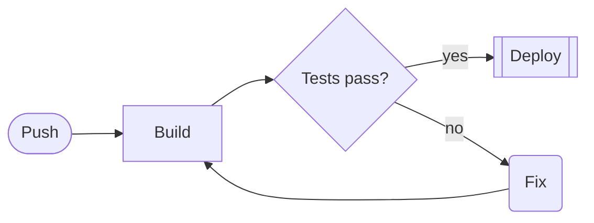

# nymph: charts from YAML

You write a small YAML source; nymph draws it as a PNG. The PNG carries
its source, so it can be read back and changed later.

## How to run it

- With the nymph MCP tools: `render_chart` (returns the image; give
  `output_path` to also save a `.png`), `example_chart`, `chart_schema`,
  `check_chart`, `extract_chart` (the source of a nymph PNG), `list_fonts`,
  `convert_chart` (mermaid to nymph YAML). `render_chart` and
  `check_chart` take mermaid as well as nymph YAML in `source`.
- Without them: the `nymph` command. `nymph chart.yaml` writes
  `chart.png`; `nymph example PlotLine` prints an example; `nymph schema
  PlotLine` lists fields; `nymph check chart.yaml` validates; `nymph
  chart.png` prints the source back; `nymph diagram.mmd` draws mermaid
  and `nymph convert diagram.mmd -o diagram.yaml` converts it. Exit code 0 is success; on 1, one
  line on standard error says why. When `nymph` is not on `PATH`, it is
  `bin/nymph` in this skill's folder: run it by that path (once `chmod
  +x` if it is not executable), with `--rasterizer software`.

## Workflow

Do not write a source from memory and fix it by trial and error. Start
from a working one and look up every field you use.

1. **Choose the root element** from the table below.
2. **Get an example:** `example_chart` with that type (or with a type you
   need inside it, such as `PlotHeatmap`, `Window`, `ClassDiagram`). It
   returns a complete source that renders; copy it and change it. Without
   `type` it lists every example and the element types it uses.
3. **Get the fields** of each element type you add or change, with
   `chart_schema` (one call per type, in parallel): names, types,
   defaults, allowed values, and where the element goes. Use only names
   it lists; they are exact.
4. If you computed or fetched the data, record how in the `source` key
   (the prompt, query or code).
5. Render it. An error names `<line>:<column>` in the source and usually
   suggests the right name: fix that spot and render again.
6. Look at the image and improve it if it is unclear, then show it. When
   you made it with the command in a sandbox the user cannot see, give
   them the PNG as a file (and the YAML, which they need to change it).
7. To change a nymph PNG, read its source back first (`extract_chart`).
   Its `view` key keeps the zoom the user chose in the viewer: keep it
   unless asked.
8. Where the chart is shown live (the nymph viewer in the conversation),
   the user can pan, zoom, hide series and click points. You then get a
   note starting `nymph chart "...": the user changed the view.` with a
   `view:` block and the last clicked point. "This", "here" or "what I'm
   looking at" mean that view and point. When you render the chart
   again, put that `view:` block in the source (replacing any `view`
   key) so the user keeps their zoom; leave it out to show the whole
   chart again.
9. When the user has a chart open in the nymph editor (`nymph view
   --edit`), work on that chart with the `editor_*` tools instead of
   rendering a new one: `editor_state` first (the elements by path, the
   selection, which is what "this" means, and the tables), then
   `editor_add_element`, `editor_set_fields`, `editor_remove_element`,
   `editor_set_cells` with the `expected_version` it returned, and
   `editor_view_image` to see the result. Each change shows in the
   editor at once and the user can undo it. Without an open editor they
   say so: then use `render_chart`.

| To draw | Root element |
|---|---|
| One chart: lines, bars, scatter, pie, histogram, heatmap, error bars | `Plot` (2D) with series as `children` |
| A 3D surface, mesh, line or scatter | `Plot3D` |
| Several charts, labels, a dashboard | `VerticalLayout` / `HorizontalLayout` of plots and `Label`s |
| UML class, sequence, state, activity, use case, component, deployment, object, package | `ClassDiagram`, `SequenceDiagram`, `StateDiagram`, `ActivityDiagram`, `UseCaseDiagram`, `ComponentDiagram`, `DeploymentDiagram`, `ObjectDiagram`, `PackageDiagram` |
| ER, network, data flow, process flow, mind map, org chart | `ERDiagram`, `NetworkDiagram`, `DataFlowDiagram`, `Flowchart`, `MindMap`, `OrgChart` |
| Schedule, flows between quantities | `GanttChart`, `SankeyDiagram` |
| A user-interface mockup | `Screen` of `Window`s holding ImGui widgets by their ImGui names (`Button`, `SliderFloat`, `Table`, ...), `Image` placeholders, `WindowTransition` arrows |

## Source

```yaml
description: Monthly revenue against cost, 2025.   # the alt text
image: {width: 800, height: 450}
root:
  type: Plot
  title: Revenue vs cost
  x_label: month
  y_label: kUSD
  children:
    - {type: PlotLine, label: revenue, xs: $month, ys: $revenue}
    - {type: PlotBars, label: cost, xs: $month, ys: $cost}
data: |
  month, revenue, cost
  1, 12, 9
  2, 15, 9.5
  3, 11, 10
```

- `root` is one element; the others go in `children`.
- `$name` takes a column from `data` (CSV in a `|` block, or
  `{name: [values]}`); `$table:name` from one of several named tables.
- Names are exact: an unknown type, field or flag is an error.

Rules that cause most errors: indent with spaces; quote colours
(`color: "#C0392B"`, an unquoted `#` starts a comment); never quote
numbers; quote text containing `: `; CSV in `data: |`, never `>`.

## Diagrams: draft in mermaid, finish in nymph

For a diagram whose structure is still changing (flowchart, sequence,
class, state, ER, Gantt, pie, mind map, Sankey, xychart), you may reason
and write in mermaid, which you know well, instead of nymph YAML:

1. Write mermaid as you normally would and pass it to `render_chart` as
   `source` (or `input_path` to a `.mmd` file). nymph converts it and
   draws it; the result names the mermaid kind and any **warnings**
   (things nymph drops, such as `click` or icons). Errors give the
   `<line>:<column>` in your mermaid.
2. Revise the mermaid and render again until the user is satisfied. In an
   open editor, `editor_set_source` takes mermaid too.
3. **Convert**: `convert_chart` with the same mermaid (and `output_path`
   ending in `.yaml` to save it) returns the nymph YAML. From then on edit
   that YAML, not the mermaid: colours, fonts, `shape` / `symbol`, layout
   hints (`rank`, `weight`, `min_length`), sizes, notes, and anything
   mermaid cannot say. Look its fields up with `chart_schema` as usual.



nymph writes only PNG and YAML: a PNG drawn from mermaid carries the
converted YAML, never the mermaid, so `extract_chart` on it gives YAML.
Write plots, dashboards and user interfaces in YAML directly; mermaid
kinds nymph has no element for (`gitGraph`, `C4`, `timeline`, ...) are
an error that lists the ones it reads.

## A good chart

Give it a title, axis labels with units, a label per series and a real
`description`. Category names go on ticks (`x_ticks: [0, 1, 2]`,
`x_tick_labels: [Q1, Q2, Q3]`); dates are UNIX seconds with `x_scale:
Time`. Start bar charts at 0 (`y_min: 0` with `y_max`). Keep pies round
with `flags: Equal`, `x_min: 0` and `x_max: 1` on the plot. Keep about
five series per plot. Use `image: {scale: 2}` for images shown large.

## More help

Only if the example and the schema leave a question open: the guide
`reference.md` (the next file; the MCP resource `nymph://docs/agent-guide`)
has a recipe per chart type under a `### ` heading and a table of common
errors under `## Common errors`. Read just that section (search for the
heading), never the whole file. The fields of every element are in
`nymph://docs/elements` and `nymph schema`.
