# nymph — Examples

Each example is a source in [`examples/`](../examples) with the PNG nymph
renders from it. To render one:

```sh
nymph examples/line.yaml          # writes examples/line.png
```

Every PNG carries its source: `nymph examples/line.png` prints
`examples/line.yaml` back byte for byte (a test checks this for all of
them). See [format.md](format.md) for the format and
[agent-guide.md](agent-guide.md) for recipes.

## Line chart

Two series with fixed colours, a thicker line and markers, a fixed 0-100 Y range.

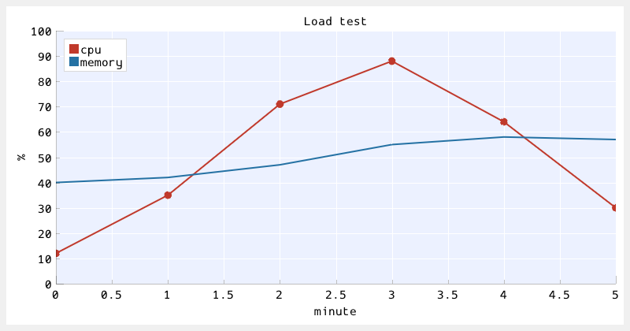

[`examples/line.yaml`](../examples/line.yaml):

```yaml
nymph: 1
description: CPU and memory use during the load test, per minute.
image: {width: 800, height: 420}
root:
  type: Plot
  title: Load test
  x_label: minute
  y_label: "%"
  y_min: 0
  y_max: 100
  children:
    - type: PlotLine
      label: cpu
      xs: $minute
      ys: $cpu
      color: "#C0392B"
      line_weight: 2
      marker: Circle
    - type: PlotLine
      label: memory
      xs: $minute
      ys: $mem
      color: "#2471A3"
      line_weight: 2
data: |
  minute, cpu, mem
  0, 12, 40
  1, 35, 42
  2, 71, 47
  3, 88, 55
  4, 64, 58
  5, 30, 57
```

## Bar chart

Bars with an `x_min`/`x_max` half a step beyond the outer bars, and a horizontal target line (`PlotInfLines`).

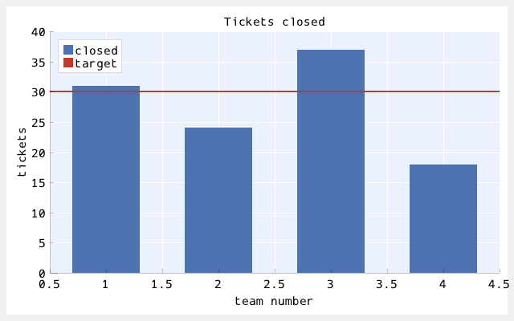

[`examples/bars.yaml`](../examples/bars.yaml):

```yaml
nymph: 1
description: Tickets closed per team last sprint, against a target of 30.
image: {width: 640, height: 400}
root:
  type: Plot
  title: Tickets closed
  x_label: team number
  y_label: tickets
  x_min: 0.5
  x_max: 4.5
  y_min: 0
  y_max: 40
  children:
    - type: PlotBars
      label: closed
      xs: $team
      ys: $closed
      bar_size: 0.6
    - type: PlotInfLines
      label: target
      values: [30]
      horizontal: true
      color: "#C0392B"
      line_weight: 2
data: |
  team, closed
  1, 31
  2, 24
  3, 37
  4, 18
```

## Grouped bars

Two series side by side per quarter with `PlotBarGroups`: `values: [$north, $south]` gives one row per group; the Plot's `x_ticks` and `x_tick_labels` (here a text column) name the groups, and `y_format` adds the unit.

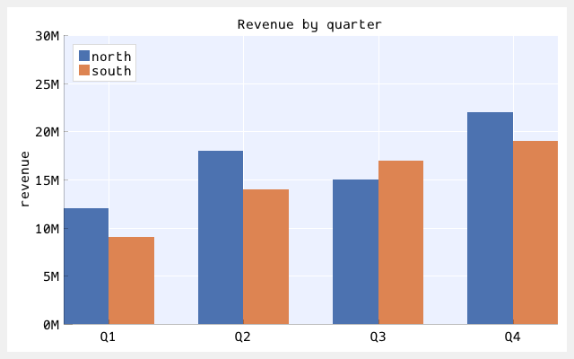

[`examples/bar_groups.yaml`](../examples/bar_groups.yaml):

```yaml
nymph: 1
description: Revenue per quarter in two regions, in millions.
image: {width: 640, height: 400}
root:
  type: Plot
  title: Revenue by quarter
  y_label: revenue
  y_format: "%.0fM"
  x_ticks: [0, 1, 2, 3]
  x_tick_labels: $quarter
  y_min: 0
  y_max: 30
  legend_location: NorthWest
  children:
    - type: PlotBarGroups
      labels: [north, south]
      values: [$north, $south]
data: |
  quarter, north, south
  Q1, 12, 9
  Q2, 18, 14
  Q3, 15, 17
  Q4, 22, 19
```

## Error bars, annotations and tags

Asymmetric error bars (`neg`, `pos`) that take the colour of the line before them, a callout on the outlier with `PlotAnnotation`, and a `PlotTag` naming the budget line on the Y axis.

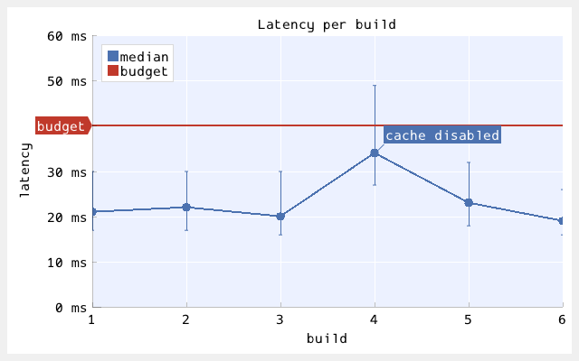

[`examples/error_bars.yaml`](../examples/error_bars.yaml):

```yaml
nymph: 1
description: Median request latency per build, with the 10th to 90th percentile spread, against a 40 ms budget.
image: {width: 640, height: 400}
root:
  type: Plot
  title: Latency per build
  x_label: build
  y_label: latency
  y_format: "%.0f ms"
  x_ticks: [1, 2, 3, 4, 5, 6]
  y_min: 0
  y_max: 60
  children:
    - type: PlotLine
      label: median
      xs: $build
      ys: $median
      marker: Circle
      line_weight: 2
    - type: PlotErrorBars
      xs: $build
      ys: $median
      neg: $below
      pos: $above
    - type: PlotAnnotation
      x: 4
      y: 34
      text: cache disabled
    - type: PlotInfLines
      label: budget
      values: [40]
      horizontal: true
      color: "#C0392B"
      line_weight: 2
    - type: PlotTag
      value: 40
      text: budget
data: |
  build, median, below, above
  1, 21, 4, 9
  2, 22, 5, 8
  3, 20, 4, 10
  4, 34, 7, 15
  5, 23, 5, 9
  6, 19, 3, 7
```

## Time and log axes, second Y axis

`x_scale: Time` reads UNIX seconds and labels them in UTC; `y_scale: Log10` fits values from 60 to 21000; the error rate uses `y_axis: Y2`, the axis on the right, with its own range and format.

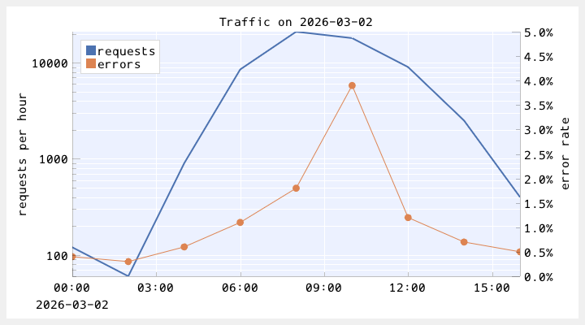

[`examples/time_axes.yaml`](../examples/time_axes.yaml):

```yaml
nymph: 1
description: Requests per hour (log scale, left) and error rate (right) over one day, times in UTC.
image: {width: 720, height: 400}
root:
  type: Plot
  title: Traffic on 2026-03-02
  x_scale: Time
  y_scale: Log10
  y_label: requests per hour
  y2_label: error rate
  y2_format: "%.1f%%"
  y2_min: 0
  y2_max: 5
  children:
    - type: PlotLine
      label: requests
      xs: $time
      ys: $requests
      line_weight: 2
    - type: PlotLine
      label: errors
      xs: $time
      ys: $errors
      y_axis: Y2
      marker: Circle
data: |
  time, requests, errors
  1772409600, 120, 0.4
  1772416800, 60, 0.3
  1772424000, 900, 0.6
  1772431200, 8500, 1.1
  1772438400, 21000, 1.8
  1772445600, 18000, 3.9
  1772452800, 9000, 1.2
  1772460000, 2500, 0.7
  1772467200, 400, 0.5
```

## Histogram

Raw samples binned by nymph; the data is given as a column list instead of CSV.

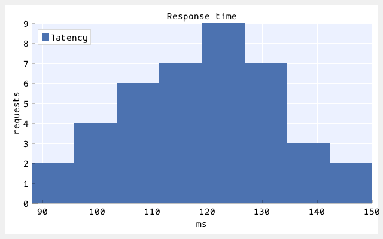

[`examples/histogram.yaml`](../examples/histogram.yaml):

```yaml
nymph: 1
description: Distribution of 40 API response times, in milliseconds.
image: {width: 640, height: 400}
root:
  type: Plot
  title: Response time
  x_label: ms
  y_label: requests
  children:
    - type: PlotHistogram
      label: latency
      values: $ms
      bins: 8
data:
  ms: [118, 131, 96, 143, 110, 125, 88, 138, 121, 114,
       102, 127, 119, 133, 109, 98, 122, 117, 141, 129,
       112, 105, 124, 136, 115, 120, 93, 126, 111, 130,
       107, 123, 116, 150, 101, 128, 113, 134, 119, 104]
```

## Heatmap

A 4 x 5 grid built from five CSV columns with `[$mon, $tue, ...]`, on the `Viridis` scale. `x_ticks` / `y_ticks` with tick labels name the cells (the heatmap spans 0 to 1, so the cell centres are at 0.1, 0.3, ...), and a `ColorScale` beside the plot shows what the colours mean.

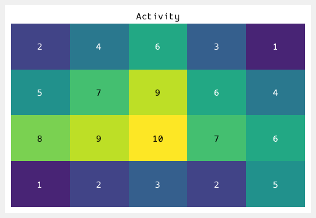

[`examples/heatmap.yaml`](../examples/heatmap.yaml):

```yaml
nymph: 1
description: Activity by weekday (columns) and time of day (rows, morning at the top).
image: {width: 520, height: 360}
root:
  type: HorizontalLayout
  spacing: 8
  children:
    - type: Plot
      title: Activity
      width: -1
      height: -1
      colormap: Viridis
      flags: NoLegend
      x_flags: NoGridLines|NoTickMarks
      y_flags: NoGridLines|NoTickMarks
      x_ticks: [0.1, 0.3, 0.5, 0.7, 0.9]
      x_tick_labels: [Mon, Tue, Wed, Thu, Fri]
      y_ticks: [0.875, 0.625, 0.375, 0.125]
      y_tick_labels: $slot
      children:
        - type: PlotHeatmap
          label: activity
          rows: 4
          cols: 5
          values: [$mon, $tue, $wed, $thu, $fri]
          scale_min: 0
          scale_max: 10
          format: "%.0f"
    - type: ColorScale
      label: events
      height: -1
      scale_min: 0
      scale_max: 10
      colormap: Viridis
data: |
  slot, mon, tue, wed, thu, fri
  morning, 2, 4, 6, 3, 1
  noon, 5, 7, 9, 6, 4
  evening, 8, 9, 10, 7, 6
  night, 1, 2, 3, 2, 5
```

## Pie chart

Kept round by `Equal` and a fixed X range; legend outside on the right.

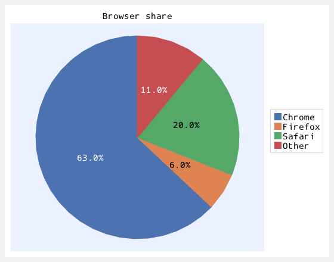

[`examples/pie.yaml`](../examples/pie.yaml):

```yaml
nymph: 1
description: Share of traffic by browser, in percent.
image: {width: 560, height: 440}
root:
  type: Plot
  title: Browser share
  flags: Equal
  legend_location: East
  legend_flags: Outside
  x_flags: NoDecorations
  y_flags: NoDecorations
  x_min: 0
  x_max: 1
  children:
    - type: PlotPieChart
      labels: $browser
      values: $share
      normalize: true
data: |
  browser, share
  Chrome, 63
  Firefox, 6
  Safari, 20
  Other, 11
```

## Scatter

Two groups with different markers and a fixed range so no point sits on the edge.

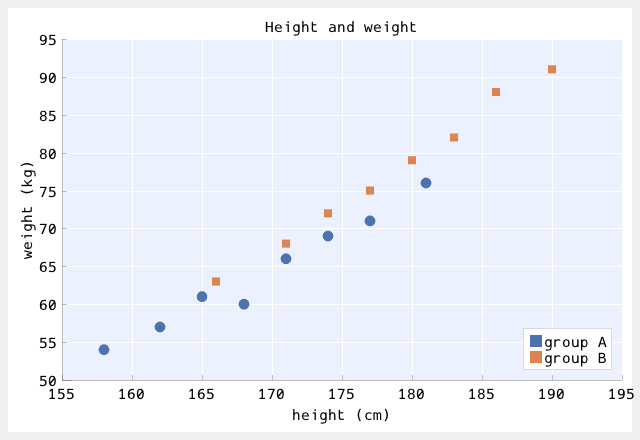

[`examples/scatter.yaml`](../examples/scatter.yaml):

```yaml
nymph: 1
description: Height against weight for two groups of 8 people.
image: {width: 640, height: 440}
root:
  type: Plot
  title: Height and weight
  x_label: height (cm)
  y_label: weight (kg)
  legend_location: SouthEast
  x_min: 155
  x_max: 195
  y_min: 50
  y_max: 95
  children:
    - type: PlotScatter
      label: group A
      xs: $height_a
      ys: $weight_a
      marker: Circle
      marker_size: 5
    - type: PlotScatter
      label: group B
      xs: $height_b
      ys: $weight_b
      marker: Square
      marker_size: 5
data: |
  height_a, weight_a, height_b, weight_b
  158, 54, 166, 63
  162, 57, 171, 68
  165, 61, 174, 72
  168, 60, 177, 75
  171, 66, 180, 79
  174, 69, 183, 82
  177, 71, 186, 88
  181, 76, 190, 91
```

## 3D surface

A 9 x 9 grid listed row by row, coloured by `Viridis`.

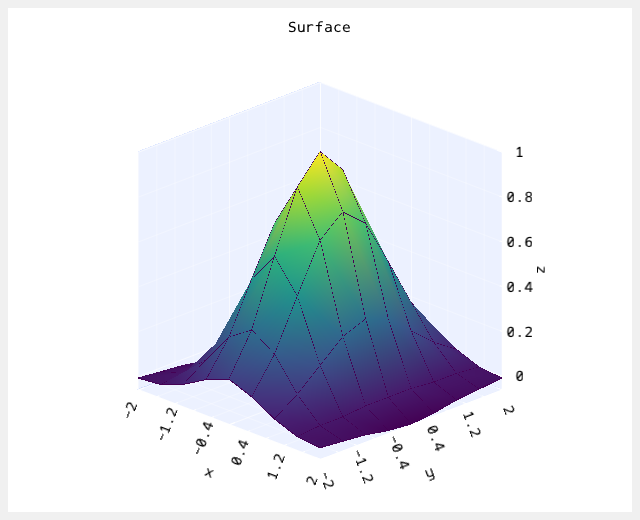

[`examples/surface.yaml`](../examples/surface.yaml):

```yaml
nymph: 1
description: A bump, z = exp(-(x^2 + y^2) / 2) * cos(x), on a 9 by 9 grid.
image: {width: 640, height: 520}
root:
  type: Plot3D
  title: Surface
  x_label: x
  y_label: y
  z_label: z
  colormap: Viridis
  flags: NoLegend
  children:
    - type: Plot3DSurface
      label: z
      xs: $x
      ys: $y
      zs: $z
      x_count: 9
      y_count: 9
data: |
  x, y, z
  -2, -2, -0.01
  -1.5, -2, 0.00
  -1, -2, 0.04
  -0.5, -2, 0.10
  0, -2, 0.14
  0.5, -2, 0.10
  1, -2, 0.04
  1.5, -2, 0.00
  2, -2, -0.01
  -2, -1.5, -0.02
  -1.5, -1.5, 0.01
  -1, -1.5, 0.11
  -0.5, -1.5, 0.25
  0, -1.5, 0.32
  0.5, -1.5, 0.25
  1, -1.5, 0.11
  1.5, -1.5, 0.01
  2, -1.5, -0.02
  -2, -1, -0.03
  -1.5, -1, 0.01
  -1, -1, 0.20
  -0.5, -1, 0.47
  0, -1, 0.61
  0.5, -1, 0.47
  1, -1, 0.20
  1.5, -1, 0.01
  2, -1, -0.03
  -2, -0.5, -0.05
  -1.5, -0.5, 0.02
  -1, -0.5, 0.29
  -0.5, -0.5, 0.68
  0, -0.5, 0.88
  0.5, -0.5, 0.68
  1, -0.5, 0.29
  1.5, -0.5, 0.02
  2, -0.5, -0.05
  -2, 0, -0.06
  -1.5, 0, 0.02
  -1, 0, 0.33
  -0.5, 0, 0.77
  0, 0, 1.00
  0.5, 0, 0.77
  1, 0, 0.33
  1.5, 0, 0.02
  2, 0, -0.06
  -2, 0.5, -0.05
  -1.5, 0.5, 0.02
  -1, 0.5, 0.29
  -0.5, 0.5, 0.68
  0, 0.5, 0.88
  0.5, 0.5, 0.68
  1, 0.5, 0.29
  1.5, 0.5, 0.02
  2, 0.5, -0.05
  -2, 1, -0.03
  -1.5, 1, 0.01
  -1, 1, 0.20
  -0.5, 1, 0.47
  0, 1, 0.61
  0.5, 1, 0.47
  1, 1, 0.20
  1.5, 1, 0.01
  2, 1, -0.03
  -2, 1.5, -0.02
  -1.5, 1.5, 0.01
  -1, 1.5, 0.11
  -0.5, 1.5, 0.25
  0, 1.5, 0.32
  0.5, 1.5, 0.25
  1, 1.5, 0.11
  1.5, 1.5, 0.01
  2, 1.5, -0.02
  -2, 2, -0.01
  -1.5, 2, 0.00
  -1, 2, 0.04
  -0.5, 2, 0.10
  0, 2, 0.14
  0.5, 2, 0.10
  1, 2, 0.04
  1.5, 2, 0.00
  2, 2, -0.01
```

## Two named tables

A monthly series and a per-region summary of different lengths, as two named tables under `data` referenced with `$table:column`; `source` records the prompt and code that produced the numbers.

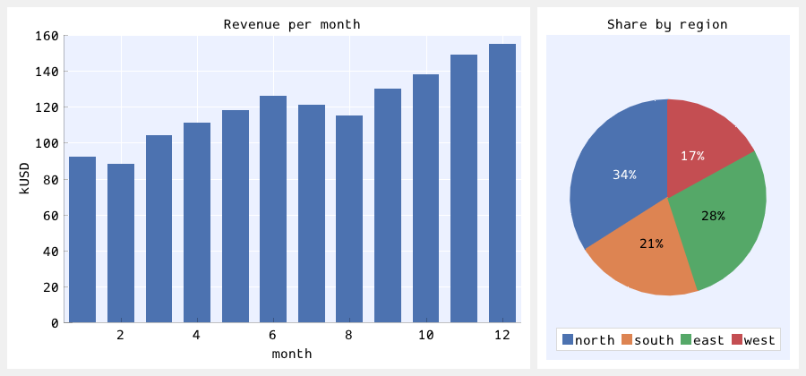

[`examples/tables.yaml`](../examples/tables.yaml):

```yaml
nymph: 1
description: >-
  Monthly revenue in 2025 next to each region's share of the year's total,
  from two tables of different lengths.
source:
  prompt: Chart 2025 revenue by month, and each region's share of the total.
  code: |
    import pandas as pd
    df = pd.read_csv("orders_2025.csv", parse_dates=["date"])
    monthly = df.groupby(df.date.dt.month).revenue.sum() / 1000
    regions = df.groupby("region").revenue.sum()
    share = (100 * regions / regions.sum()).round()
  language: python
image: {width: 900, height: 420}
root:
  type: HorizontalLayout
  spacing: 8
  children:
    - type: Plot
      title: Revenue per month
      width: -2
      height: -1
      x_label: month
      y_label: kUSD
      x_min: 0.5
      x_max: 12.5
      y_min: 0
      y_max: 160
      flags: NoLegend
      children:
        - {type: PlotBars, label: revenue, xs: $monthly:month, ys: $monthly:revenue, bar_size: 0.7}
    - type: Plot
      title: Share by region
      width: -1
      height: -1
      flags: Equal
      legend_location: South
      legend_flags: Horizontal
      x_flags: NoDecorations
      y_flags: NoDecorations
      x_min: 0
      x_max: 1
      children:
        - {type: PlotPieChart, labels: $regions:name, values: $regions:share, label_fmt: "%.0f%%"}
data:
  monthly: |
    month, revenue
    1, 92
    2, 88
    3, 104
    4, 111
    5, 118
    6, 126
    7, 121
    8, 115
    9, 130
    10, 138
    11, 149
    12, 155
  regions:
    name: [north, south, east, west]
    share: [34, 21, 28, 17]
```

## Fonts and text colour

Embedded fonts by file name: Fira Sans for the whole image, a PT Serif heading, an italic note, Fira Mono and a blue text colour on the cost chart, a bold red `PlotText`.

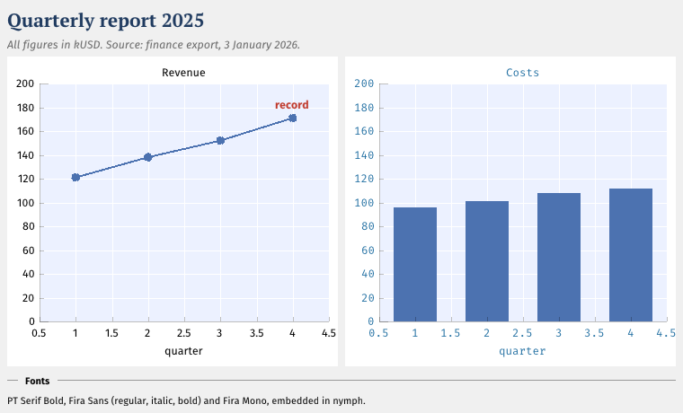

[`examples/fonts.yaml`](../examples/fonts.yaml):

```yaml
nymph: 1
description: >-
  Quarterly revenue and costs in 2025, styled with embedded fonts: a serif
  heading, an italic note, and monospaced numbers in the cost chart.
image: {width: 760, height: 460, font: FiraSans-Regular.ttf, font_size: 15}
root:
  type: VerticalLayout
  spacing: 6
  children:
    - {type: Label, text: Quarterly report 2025, font: PT_Serif-Web-Bold.ttf, font_size: 28, text_color: "#1F3A5F"}
    - type: Label
      text: "All figures in kUSD. Source: finance export, 3 January 2026."
      font: FiraSans-Italic.ttf
      text_color_light: "#666666"
      text_color_dark: "#AAAAAA"
    - type: HorizontalLayout
      spacing: 8
      height: -1
      children:
        - type: Plot
          title: Revenue
          width: -1
          height: -1
          x_label: quarter
          x_min: 0.5
          x_max: 4.5
          y_min: 0
          y_max: 200
          flags: NoLegend
          children:
            - {type: PlotLine, label: revenue, xs: $quarter, ys: $revenue, line_weight: 2, marker: Circle}
            - {type: PlotText, text: record, x: 4, y: 182, font: FiraSans-Bold.ttf, text_color: "#C0392B"}
        - type: Plot
          title: Costs
          width: -1
          height: -1
          x_label: quarter
          x_min: 0.5
          x_max: 4.5
          y_min: 0
          y_max: 200
          flags: NoLegend
          font: FiraMono-Regular.ttf
          text_color: "#2471A3"
          children:
            - {type: PlotBars, label: costs, xs: $quarter, ys: $cost, bar_size: 0.6}
    - {type: SeparatorText, label: Fonts, font: FiraSans-Bold.ttf, font_size: 13}
    - {type: Label, text: "PT Serif Bold, Fira Sans (regular, italic, bold) and Fira Mono, embedded in nymph.", font_size: 13}
data: |
  quarter, revenue, cost
  1, 121, 96
  2, 138, 101
  3, 152, 108
  4, 171, 112
```

## Several plots with labels

A heading, a separator, two stacked plots next to a pie, and a source note: nested layouts with stretch sizes (`height: -1`, `width: -2`).


[`examples/dashboard.yaml`](../examples/dashboard.yaml):

```yaml
nymph: 1
description: >-
  Greenhouse sensors on 12 March: temperature and humidity through the day,
  next to the share of time each vent was open.
image: {width: 900, height: 560}
root:
  type: VerticalLayout
  spacing: 6
  children:
    - type: Label
      text: Greenhouse sensors, 12 March
    - type: Separator
    - type: HorizontalLayout
      spacing: 8
      height: -1
      children:
        - type: VerticalLayout
          spacing: 6
          width: -2
          children:
            - type: Plot
              title: Temperature
              height: -1
              y_label: C
              flags: NoLegend
              children:
                - {type: PlotLine, label: temp, xs: $hour, ys: $temp, color: "#C0392B", line_weight: 2}
            - type: Plot
              title: Humidity
              height: -1
              x_label: hour
              y_label: "%"
              flags: NoLegend
              children:
                - {type: PlotShaded, label: humidity, xs: $hour, ys: $hum, color: "#2471A3", fill_alpha: 0.25}
                - {type: PlotLine, label: humidity, xs: $hour, ys: $hum, color: "#2471A3", line_weight: 2}
        - type: Plot
          title: Vent open time
          width: -1
          height: -1
          flags: Equal
          legend_location: South
          legend_flags: Horizontal
          x_flags: NoDecorations
          y_flags: NoDecorations
          x_min: 0
          x_max: 1
          children:
            - {type: PlotPieChart, labels: "north\nsouth\nroof", values: [45, 35, 20], label_fmt: "%.0f%%"}
    - type: Label
      text: "Source: station 14. Readings every 2 hours."
      text_color_light: "#666666"
      text_color_dark: "#AAAAAA"
data: |
  hour, temp, hum
  0, 12.8, 73
  2, 12.1, 75
  4, 11.6, 77
  6, 14.9, 66
  8, 18.4, 58
  10, 21.7, 50
  12, 23.2, 47
  14, 24.0, 45
  16, 22.8, 48
  18, 21.0, 52
  20, 17.3, 61
  22, 14.6, 68
```

## UML class diagram

Classes with attribute and method compartments, an abstract class (italic, from the embedded italic font), inheritance, an aggregation with multiplicities, and a note. Laid out automatically, parents above.

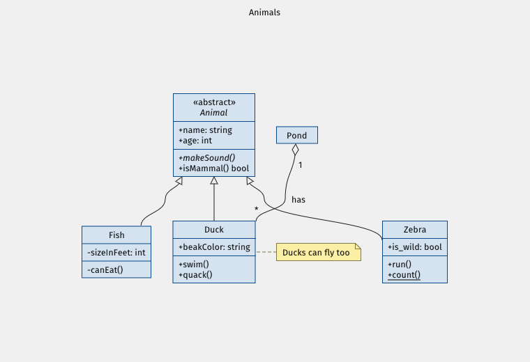

[`examples/uml_class.yaml`](../examples/uml_class.yaml):

```yaml
nymph: 1
description: UML class diagram of animals, an abstract Animal and three subclasses, and a Pond aggregating ducks.
image: {width: 760, height: 520, font: FiraSans-Regular.ttf, font_size: 15}
root:
  type: ClassDiagram
  title: Animals
  children:
    - type: Class
      id: Animal
      kind: Abstract
      attributes: ["+name: string", "+age: int"]
      methods: ["+makeSound()*", "+isMammal() bool"]
    - {type: Class, id: Duck, attributes: ["+beakColor: string"], methods: ["+swim()", "+quack()"]}
    - {type: Class, id: Fish, attributes: ["-sizeInFeet: int"], methods: ["-canEat()"]}
    - {type: Class, id: Zebra, attributes: ["+is_wild: bool"], methods: ["+run()", "+count()$"]}
    - {type: Class, id: Pond}
    - {type: ClassRelation, from: Duck, to: Animal, kind: Inheritance}
    - {type: ClassRelation, from: Fish, to: Animal, kind: Inheritance}
    - {type: ClassRelation, from: Zebra, to: Animal, kind: Inheritance}
    - {type: ClassRelation, from: Pond, to: Duck, kind: Aggregation, from_label: "1", to_label: "*", label: has}
    - {type: Note, text: "Ducks can fly too", attach: [Duck]}
```

## UML sequence diagram

Participants (an actor, a box, a database), numbered messages, activation bars, an `alt` fragment with an `Else`, a self message and a note over two lifelines.

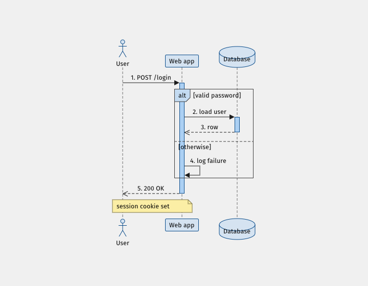

[`examples/uml_sequence.yaml`](../examples/uml_sequence.yaml):

```yaml
nymph: 1
description: UML sequence diagram of a login between a user, web app and database, with an alt fragment for a wrong password.
image: {width: 720, height: 560, font: FiraSans-Regular.ttf, font_size: 15}
root:
  type: SequenceDiagram
  autonumber: true
  children:
    - {type: Participant, id: user, name: User, kind: Actor}
    - {type: Participant, id: web, name: Web app}
    - {type: Participant, id: db, name: Database, kind: Database}
    - {type: Message, from: user, to: web, text: "POST /login", activate: true}
    - type: Fragment
      kind: Alt
      label: valid password
      children:
        - {type: Message, from: web, to: db, text: load user, activate: true}
        - {type: Message, from: db, to: web, text: row, kind: Reply, deactivate: true}
        - {type: Else, label: otherwise}
        - {type: Message, from: web, to: web, text: log failure}
    - {type: Message, from: web, to: user, text: "200 OK", kind: Reply, deactivate: true}
    - {type: Note, text: session cookie set, over: [user, web]}
```

## UML state diagram

Initial and final pseudo-states, a composite state laid out inside its parent, and a note attached to an inner state.

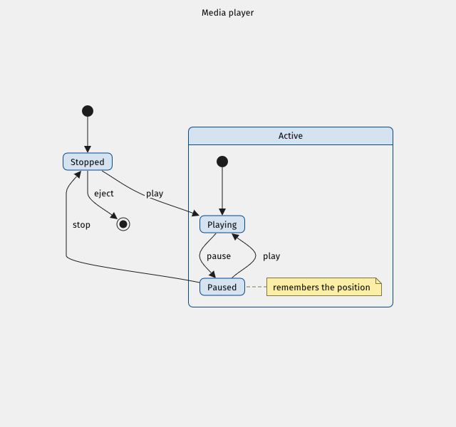

[`examples/uml_state.yaml`](../examples/uml_state.yaml):

```yaml
nymph: 1
description: UML state diagram of a media player, with a composite Active state.
image: {width: 640, height: 600, font: FiraSans-Regular.ttf, font_size: 15}
root:
  type: StateDiagram
  title: Media player
  children:
    - {type: State, id: start, kind: Initial}
    - {type: State, id: stopped, name: Stopped}
    - type: State
      id: active
      name: Active
      children:
        - {type: State, id: a0, kind: Initial}
        - {type: State, id: playing, name: Playing}
        - {type: State, id: paused, name: Paused}
        - {type: Transition, from: a0, to: playing}
        - {type: Transition, from: playing, to: paused, label: pause}
        - {type: Transition, from: paused, to: playing, label: play}
    - {type: State, id: end, kind: Final}
    - {type: Transition, from: start, to: stopped}
    - {type: Transition, from: stopped, to: playing, label: play}
    - {type: Transition, from: paused, to: stopped, label: stop}
    - {type: Transition, from: stopped, to: end, label: eject}
    - {type: Note, text: "remembers the position", attach: [paused]}
```

## UML activity diagram

An initial node, actions (one a send signal), a decision with guards, a fork and join, a merge and a final node.

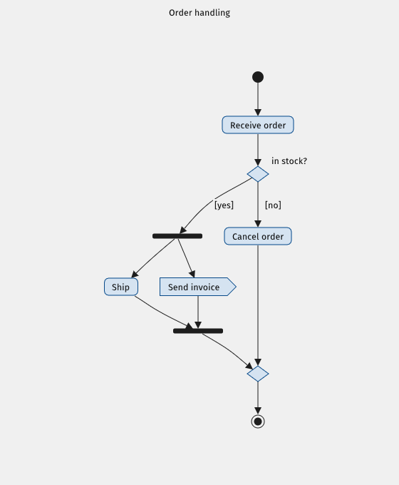

[`examples/uml_activity.yaml`](../examples/uml_activity.yaml):

```yaml
nymph: 1
description: UML activity diagram of order handling, with a decision, a fork and a join.
image: {width: 560, height: 680, font: FiraSans-Regular.ttf, font_size: 15}
root:
  type: ActivityDiagram
  title: Order handling
  children:
    - {type: ActivityControl, id: start, kind: Initial}
    - {type: Action, id: receive, text: Receive order}
    - {type: ActivityControl, id: stock, kind: Decision, label: in stock?}
    - {type: Action, id: ship, text: Ship}
    - {type: Action, id: bill, text: Send invoice, kind: Send}
    - {type: Action, id: cancel, text: Cancel order}
    - {type: ActivityControl, id: fork, kind: Fork}
    - {type: ActivityControl, id: join, kind: Join}
    - {type: ActivityControl, id: merge, kind: Merge}
    - {type: ActivityControl, id: end, kind: Final}
    - {type: Flow, from: start, to: receive}
    - {type: Flow, from: receive, to: stock}
    - {type: Flow, from: stock, to: fork, guard: yes}
    - {type: Flow, from: stock, to: cancel, guard: no}
    - {type: Flow, from: fork, to: ship}
    - {type: Flow, from: fork, to: bill}
    - {type: Flow, from: ship, to: join}
    - {type: Flow, from: bill, to: join}
    - {type: Flow, from: join, to: merge}
    - {type: Flow, from: cancel, to: merge}
    - {type: Flow, from: merge, to: end}
```

## UML use case diagram

Actors on both sides of a system boundary, associations, and dashed `«include»` / `«extend»` relations.

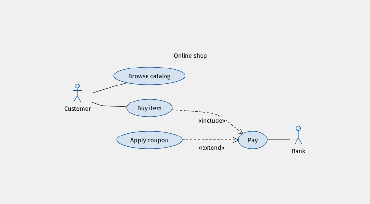

[`examples/uml_usecase.yaml`](../examples/uml_usecase.yaml):

```yaml
nymph: 1
description: UML use case diagram of an online shop, with a customer and a bank around the shop's use cases.
image: {width: 760, height: 420, font: FiraSans-Regular.ttf, font_size: 15}
root:
  type: UseCaseDiagram
  system: Online shop
  children:
    - {type: Actor, id: customer, name: Customer}
    - {type: Actor, id: bank, name: Bank, side: Right}
    - {type: UseCase, id: browse, name: Browse catalog}
    - {type: UseCase, id: buy, name: Buy item}
    - {type: UseCase, id: pay, name: Pay}
    - {type: UseCase, id: coupon, name: Apply coupon}
    - {type: UseCaseRelation, from: customer, to: browse}
    - {type: UseCaseRelation, from: customer, to: buy}
    - {type: UseCaseRelation, from: buy, to: pay, kind: Include}
    - {type: UseCaseRelation, from: coupon, to: pay, kind: Extend}
    - {type: UseCaseRelation, from: pay, to: bank}
```

## ER diagram (database structure)

Tables with typed attributes, primary / foreign / unique keys and a comment, joined by relationships in crow's foot notation; the dashed line is a non-identifying relationship.

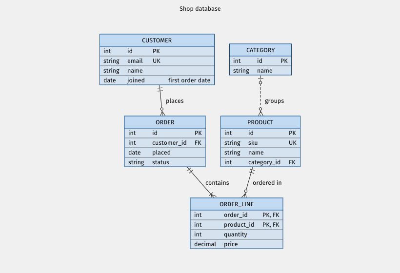

[`examples/uml_er.yaml`](../examples/uml_er.yaml):

```yaml
nymph: 1
description: Entity-relationship diagram of an online shop database, with customers, orders, order lines, products and categories.
image: {width: 820, height: 560, font: FiraSans-Regular.ttf, font_size: 15}
root:
  type: ERDiagram
  title: Shop database
  children:
    - type: Entity
      id: customer
      name: CUSTOMER
      attributes: ["int id PK", "string email UK", "string name", "date joined \"first order date\""]
    - type: Entity
      id: order
      name: ORDER
      attributes: ["int id PK", "int customer_id FK", "date placed", "string status"]
    - type: Entity
      id: line
      name: ORDER_LINE
      attributes: ["int order_id PK, FK", "int product_id PK, FK", "int quantity", "decimal price"]
    - type: Entity
      id: product
      name: PRODUCT
      attributes: ["int id PK", "string sku UK", "string name", "int category_id FK"]
    - type: Entity
      id: category
      name: CATEGORY
      attributes: ["int id PK", "string name"]
    - {type: Relationship, from: customer, to: order, from_cardinality: ExactlyOne, to_cardinality: ZeroOrMore, label: places}
    - {type: Relationship, from: order, to: line, from_cardinality: ExactlyOne, to_cardinality: OneOrMore, label: contains}
    - {type: Relationship, from: product, to: line, from_cardinality: ExactlyOne, to_cardinality: ZeroOrMore, label: "ordered in"}
    - {type: Relationship, from: category, to: product, from_cardinality: ZeroOrOne, to_cardinality: ZeroOrMore, label: groups, identifying: false}
```

## Data flow diagram

External entities (boxes), processes (numbered circles) and data stores (open-ended boxes) joined by labelled data flows; the dashed box is a trust boundary, and the two-headed flow goes both ways.

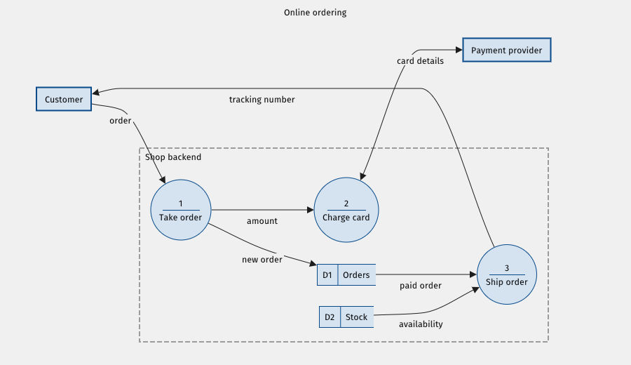

[`examples/uml_dataflow.yaml`](../examples/uml_dataflow.yaml):

```yaml
nymph: 1
description: Data flow diagram of online ordering, with a customer, a payment provider, three processes and two data stores inside the shop's trust boundary.
image: {width: 900, height: 520, font: FiraSans-Regular.ttf, font_size: 15}
root:
  type: DataFlowDiagram
  title: Online ordering
  children:
    - {type: ExternalEntity, id: customer, name: Customer}
    - {type: ExternalEntity, id: psp, name: Payment provider}
    - type: TrustBoundary
      id: shop
      name: Shop backend
      children:
        - {type: Process, id: take, name: Take order, number: "1"}
        - {type: Process, id: pay, name: Charge card, number: "2"}
        - {type: Process, id: ship, name: Ship order, number: "3"}
        - {type: DataStore, id: orders, name: Orders, number: D1}
        - {type: DataStore, id: stock, name: Stock, number: D2}
    - {type: DataFlow, from: customer, to: take, label: order}
    - {type: DataFlow, from: take, to: orders, label: new order}
    - {type: DataFlow, from: take, to: pay, label: amount}
    - {type: DataFlow, from: pay, to: psp, label: card details, bidirectional: true}
    - {type: DataFlow, from: orders, to: ship, label: paid order}
    - {type: DataFlow, from: stock, to: ship, label: availability}
    - {type: DataFlow, from: ship, to: customer, label: tracking number}
```

## Network diagram

Devices drawn as icons with their addresses, grouped into dashed zones and joined by links; the Wi-Fi link is dashed, the VPN link long-dashed, and the SQL link directed.

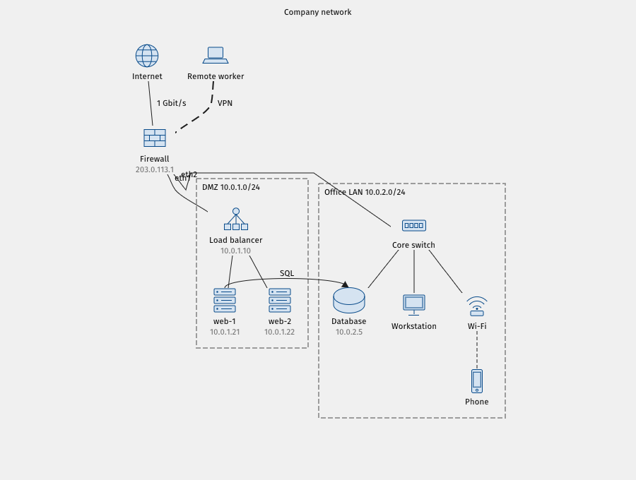

[`examples/uml_network.yaml`](../examples/uml_network.yaml):

```yaml
nymph: 1
description: Network diagram of a small company, with the internet, a firewall, a DMZ holding the web servers behind a load balancer, and an office LAN with a database, workstations and Wi-Fi.
image: {width: 900, height: 680, font: FiraSans-Regular.ttf, font_size: 14}
root:
  type: NetworkDiagram
  title: Company network
  children:
    - {type: Device, id: internet, name: Internet, kind: Internet}
    - {type: Device, id: fw, name: Firewall, kind: Firewall, address: 203.0.113.1}
    - type: Zone
      id: dmz
      name: DMZ 10.0.1.0/24
      children:
        - {type: Device, id: lb, name: Load balancer, kind: LoadBalancer, address: 10.0.1.10}
        - {type: Device, id: web1, name: web-1, kind: Server, address: 10.0.1.21}
        - {type: Device, id: web2, name: web-2, kind: Server, address: 10.0.1.22}
    - type: Zone
      id: lan
      name: Office LAN 10.0.2.0/24
      children:
        - {type: Device, id: sw, name: Core switch, kind: Switch}
        - {type: Device, id: db, name: Database, kind: Database, address: 10.0.2.5}
        - {type: Device, id: pc, name: Workstation, kind: Workstation}
        - {type: Device, id: ap, name: Wi-Fi, kind: AccessPoint}
        - {type: Device, id: phone, name: Phone, kind: Mobile}
    - {type: Device, id: remote, name: Remote worker, kind: Laptop}
    - {type: Link, from: internet, to: fw, label: 1 Gbit/s}
    - {type: Link, from: fw, to: lb, from_label: eth1}
    - {type: Link, from: lb, to: web1}
    - {type: Link, from: lb, to: web2}
    - {type: Link, from: fw, to: sw, from_label: eth2}
    - {type: Link, from: sw, to: db}
    - {type: Link, from: sw, to: pc}
    - {type: Link, from: sw, to: ap}
    - {type: Link, from: ap, to: phone, kind: Wireless}
    - {type: Link, from: web1, to: db, label: SQL, directed: true, constraint: false}
    - {type: Link, from: remote, to: fw, kind: Vpn, label: VPN}
```

## Flowchart

Every node shape, a `FlowGroup` around the deploy steps that links end at, labelled decision branches, a thick, a dotted, a plain and a two-headed link, and a note.

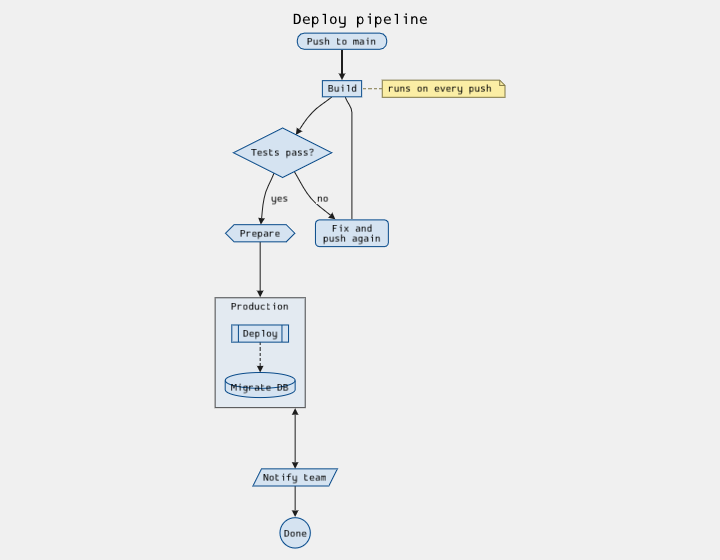

[`examples/flowchart.yaml`](../examples/flowchart.yaml):

```yaml
nymph: 1
description: How a push to main reaches production, with the deploy steps grouped.
image: {width: 720, height: 560}
root:
  type: Flowchart
  title: Deploy pipeline
  children:
    - {type: FlowNode, id: start, text: Push to main, shape: Stadium}
    - {type: FlowNode, id: build, text: Build}
    - {type: FlowNode, id: tests, text: Tests pass?, shape: Diamond}
    - {type: FlowNode, id: fix, text: "Fix and\npush again", shape: Rounded}
    - type: FlowGroup
      id: prod
      title: Production
      children:
        - {type: FlowNode, id: deploy, text: Deploy, shape: Subroutine}
        - {type: FlowNode, id: db, text: Migrate DB, shape: Cylinder}
        - {type: FlowLink, from: deploy, to: db, line: Dotted}
    - {type: FlowNode, id: notify, text: Notify team, shape: Parallelogram}
    - {type: FlowNode, id: prep, text: Prepare, shape: Hexagon}
    - {type: FlowNode, id: done, text: Done, shape: Circle}
    - {type: FlowLink, from: start, to: build, line: Thick}
    - {type: FlowLink, from: build, to: tests}
    - {type: FlowLink, from: tests, to: prep, label: "yes"}
    - {type: FlowLink, from: prep, to: prod}
    - {type: FlowLink, from: tests, to: fix, label: "no"}
    - {type: FlowLink, from: fix, to: build, arrow: None}
    - {type: FlowLink, from: prod, to: notify, arrow: Both}
    - {type: FlowLink, from: notify, to: done}
    - {type: Note, text: runs on every push, attach: [build]}
```

## Component diagram

Components with provided and required interfaces. The ball-and-socket connectors are not written: a component that `provides` an interface name and another that `requires` it are joined automatically; `ISmtp`, which nobody provides, is drawn as a socket on a stub. `Shop` contains two components, so it is a frame around them.

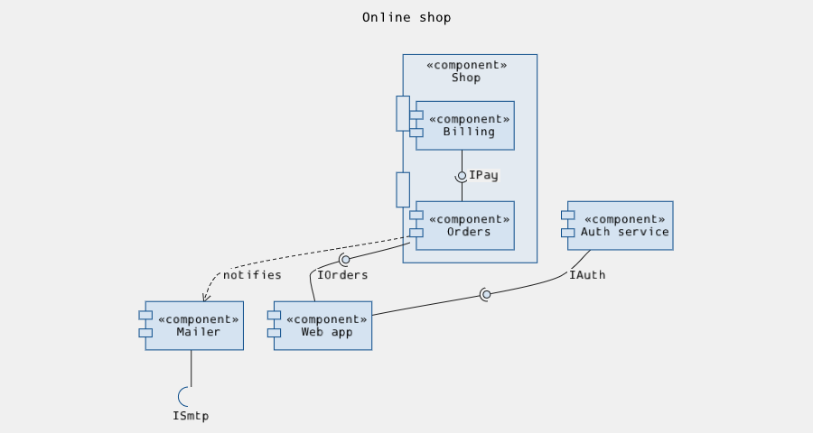

[`examples/uml_component.yaml`](../examples/uml_component.yaml):

```yaml
nymph: 1
description: A shop's components and the interfaces that wire them together.
image: {width: 900, height: 480}
root:
  type: ComponentDiagram
  title: Online shop
  children:
    - {type: Component, id: web, name: Web app, requires: [IOrders, IAuth]}
    - type: Component
      id: shop
      name: Shop
      children:
        - {type: Component, id: orders, name: Orders, provides: [IOrders], requires: [IPay]}
        - {type: Component, id: billing, name: Billing, provides: [IPay]}
    - {type: Component, id: auth, name: Auth service, provides: [IAuth]}
    - {type: Component, id: mail, name: Mailer, requires: [ISmtp]}
    - {type: ComponentLink, from: orders, to: mail, kind: Dependency, label: notifies}
```

## Deployment diagram

Nodes with what is deployed on them: nesting an artifact or a component inside a node deploys it there. A `DeploymentLink` is a communication path between nodes.

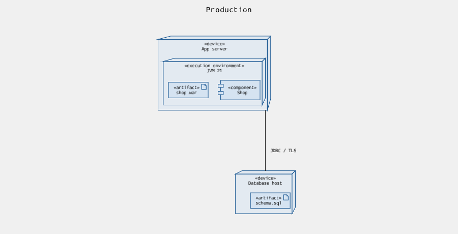

[`examples/uml_deployment.yaml`](../examples/uml_deployment.yaml):

```yaml
nymph: 1
description: An app server running a web archive, talking to a database host.
image: {width: 900, height: 460}
root:
  type: DeploymentDiagram
  title: Production
  children:
    - type: DeploymentNode
      id: srv
      name: App server
      kind: Device
      children:
        - type: DeploymentNode
          id: jvm
          name: JVM 21
          kind: ExecutionEnvironment
          children:
            - {type: Artifact, id: war, name: shop.war}
            - {type: Component, id: shop, name: Shop}
    - type: DeploymentNode
      id: db
      name: Database host
      kind: Device
      children:
        - {type: Artifact, id: schema, name: schema.sql}
    - {type: DeploymentLink, from: srv, to: db, label: JDBC / TLS}
```

## Package diagram

Packages, nested as written, and the dependencies between them (`Import`, `Access`, `Merge` or a plain `Dependency`).

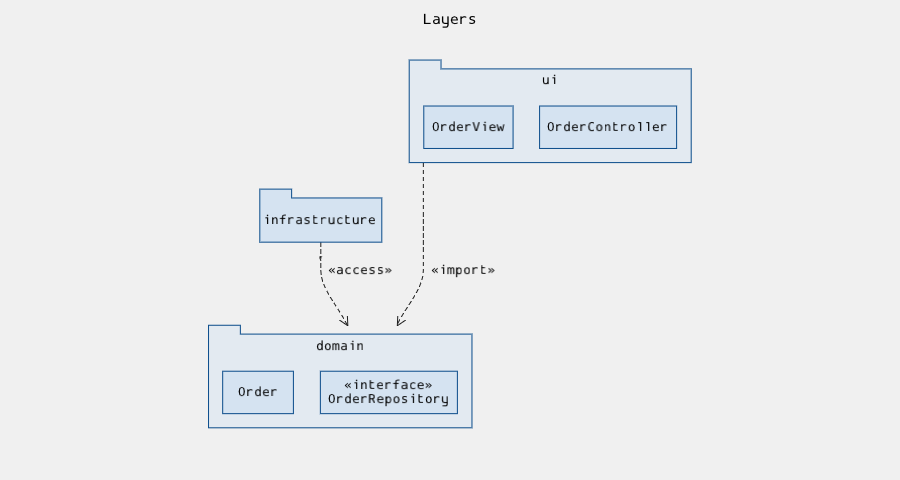

[`examples/uml_package.yaml`](../examples/uml_package.yaml):

```yaml
nymph: 1
description: Layering of an application's packages.
image: {width: 900, height: 480}
root:
  type: PackageDiagram
  title: Layers
  children:
    - type: Package
      id: ui
      name: ui
      children:
        - {type: PackageItem, id: view, name: OrderView}
        - {type: PackageItem, id: ctl, name: OrderController}
    - type: Package
      id: domain
      name: domain
      children:
        - {type: PackageItem, id: order, name: Order}
        - {type: PackageItem, id: repo, name: OrderRepository, kind: Interface}
    - {type: Package, id: infra, name: infrastructure}
    - {type: PackageRelation, from: ui, to: domain, kind: Import}
    - {type: PackageRelation, from: infra, to: domain, kind: Access}
```

## Object diagram

Instances with slot values, on the class diagram's layout. The header "name : class" is underlined; a missing name draws an anonymous instance.

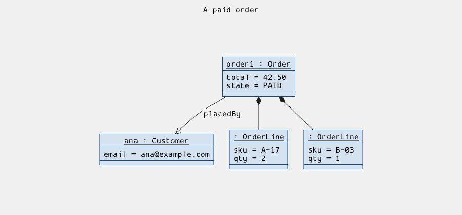

[`examples/uml_object.yaml`](../examples/uml_object.yaml):

```yaml
nymph: 1
description: An order, its customer and the line items at one moment.
image: {width: 900, height: 420}
root:
  type: ObjectDiagram
  title: A paid order
  children:
    - {type: Object, id: o1, name: order1, class: Order, slots: ["total = 42.50", "state = PAID"]}
    - {type: Object, id: c1, name: ana, class: Customer, slots: ["email = ana@example.com"]}
    - {type: Object, id: l1, class: OrderLine, slots: ["sku = A-17", "qty = 2"]}
    - {type: Object, id: l2, class: OrderLine, slots: ["sku = B-03", "qty = 1"]}
    - {type: ObjectLink, from: o1, to: c1, label: placedBy, kind: DirectedAssociation}
    - {type: ObjectLink, from: o1, to: l1, kind: Composition}
    - {type: ObjectLink, from: o1, to: l2, kind: Composition}
```

## Tree

A hierarchy written by nesting: each parent is centred over its children, siblings keep their written order, and `direction`, `edge_style` and a per-node `shape` change the look.

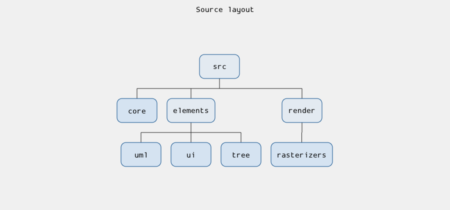

[`examples/tree.yaml`](../examples/tree.yaml):

```yaml
nymph: 1
description: The folders of a source tree.
image: {width: 900, height: 420}
root:
  type: TreeDiagram
  title: Source layout
  children:
    - type: TreeItem
      text: src
      children:
        - {type: TreeItem, text: core}
        - type: TreeItem
          text: elements
          children: [{type: TreeItem, text: uml}, {type: TreeItem, text: ui}, {type: TreeItem, text: tree}]
        - type: TreeItem
          text: render
          children: [{type: TreeItem, text: rasterizers}]
```

## Mind map

A root idea in the middle, branches to both sides balanced automatically (pin one with `side`), each branch in its own colour; a `MindLink` joins two nodes across branches without moving anything.

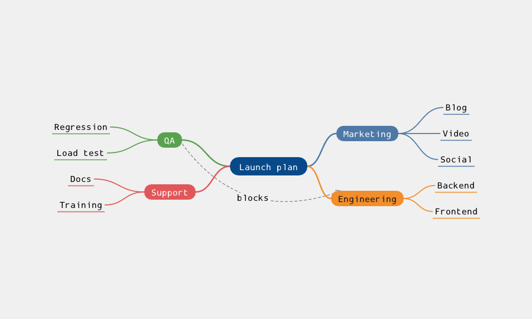

[`examples/mind_map.yaml`](../examples/mind_map.yaml):

```yaml
nymph: 1
description: A launch plan as a mind map.
image: {width: 900, height: 540}
root:
  type: MindMap
  children:
    - type: MindNode
      text: Launch plan
      children:
        - type: MindNode
          text: Marketing
          children: [{type: MindNode, text: Blog}, {type: MindNode, text: Video}, {type: MindNode, text: Social}]
        - type: MindNode
          id: eng
          text: Engineering
          children: [{type: MindNode, text: Backend}, {type: MindNode, text: Frontend}]
        - type: MindNode
          id: qa
          text: QA
          children: [{type: MindNode, text: Regression}, {type: MindNode, text: Load test}]
        - type: MindNode
          text: Support
          children: [{type: MindNode, text: Docs}, {type: MindNode, text: Training}]
    - {type: MindLink, from: qa, to: eng, label: blocks}
```

## Org chart

Cards with a portrait, a name and a title. `children_layout: Hanging` lists a team below its manager, `staff: true` puts an assistant beside the manager, `vacant: true` draws an open position and an `OrgLink` is a dotted reporting line.

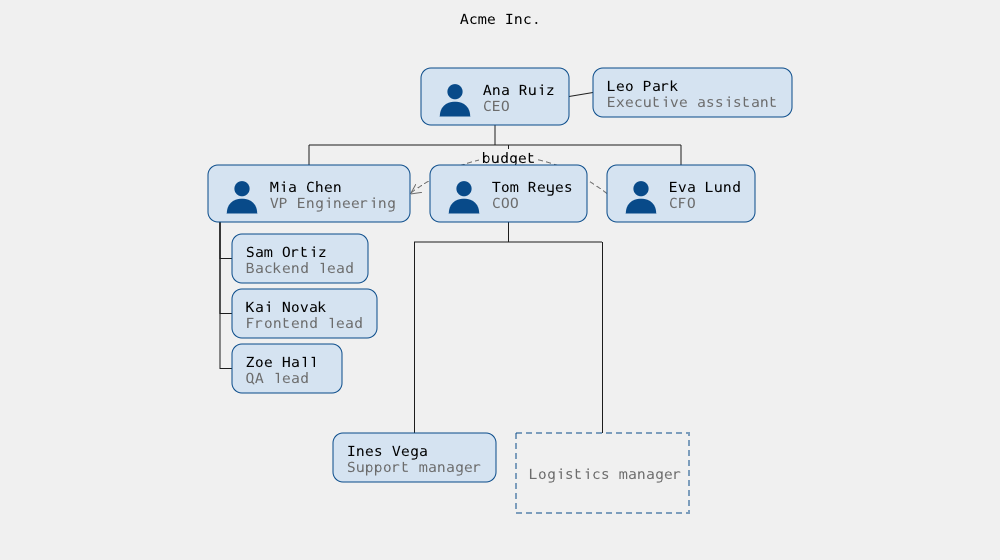

[`examples/org_chart.yaml`](../examples/org_chart.yaml):

```yaml
nymph: 1
description: A small company's org chart.
image: {width: 1000, height: 560}
root:
  type: OrgChart
  title: Acme Inc.
  children:
    - type: Person
      id: ceo
      name: Ana Ruiz
      title: CEO
      image: person
      children:
        - {type: Person, name: Leo Park, title: Executive assistant, staff: true}
        - type: Person
          id: eng
          name: Mia Chen
          title: VP Engineering
          image: person
          children_layout: Hanging
          children:
            - {type: Person, name: Sam Ortiz, title: Backend lead}
            - {type: Person, name: Kai Novak, title: Frontend lead}
            - {type: Person, name: Zoe Hall, title: QA lead}
        - type: Person
          id: ops
          name: Tom Reyes
          title: COO
          image: person
          children:
            - {type: Person, name: Ines Vega, title: Support manager}
            - {type: Person, title: Logistics manager, vacant: true}
        - {type: Person, id: cfo, name: Eva Lund, title: CFO, image: person}
    - {type: OrgLink, from: cfo, to: eng, label: budget}
```

## Gantt chart

Three sections with their own colours, tasks placed by `after` (drawn as arrows), `Done` / `Active` / `Critical` statuses, two milestones and a `today` line.

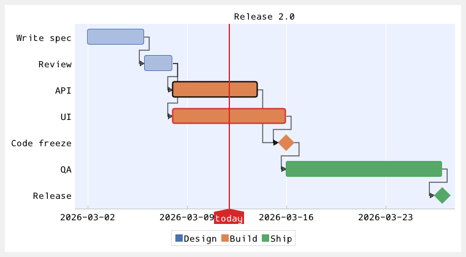

[`examples/gantt.yaml`](../examples/gantt.yaml):

```yaml
nymph: 1
description: Release 2.0 schedule in three phases, with dependencies, a code-freeze milestone and today marked.
image: {width: 760, height: 420}
root:
  type: GanttChart
  title: Release 2.0
  today: 2026-03-12
  children:
    - type: GanttSection
      name: Design
      children:
        - {type: GanttTask, id: spec, name: Write spec, start: 2026-03-02, duration: 4, status: Done}
        - {type: GanttTask, id: review, name: Review, after: [spec], duration: 2, status: Done}
    - type: GanttSection
      name: Build
      children:
        - {type: GanttTask, id: api, name: API, after: [review], duration: 6, status: Active}
        - {type: GanttTask, id: ui, name: UI, after: [review], duration: 8, status: Critical}
        - {type: GanttTask, id: freeze, name: Code freeze, after: [api, ui], milestone: true}
    - type: GanttSection
      name: Ship
      children:
        - {type: GanttTask, id: qa, name: QA, after: [freeze], end: 2026-03-27}
        - {type: GanttTask, name: Release, after: [qa], milestone: true}
```

## Sankey diagram

Flows from a CSV table mapped on with `from: $from`, `to: $to`, `values: $twh`; nodes are placed in columns automatically, and a `SankeyNode` colours the losses grey.

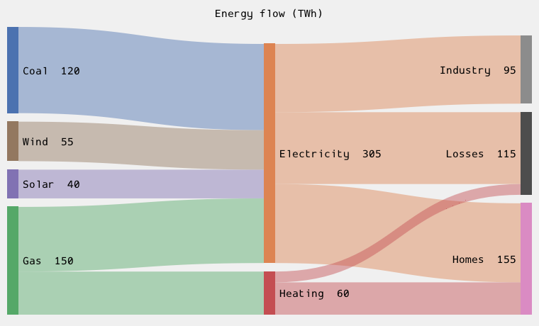

[`examples/sankey.yaml`](../examples/sankey.yaml):

```yaml
nymph: 1
description: Where the energy of a small grid comes from and where it goes, in TWh per year.
image: {width: 760, height: 460}
root:
  type: SankeyDiagram
  title: Energy flow (TWh)
  from: $from
  to: $to
  values: $twh
  value_format: "%.0f"
  children:
    - {type: SankeyNode, id: Losses, color: "#4D4D4D"}
data: |
  from, to, twh
  Coal, Electricity, 120
  Gas, Electricity, 90
  Gas, Heating, 60
  Solar, Electricity, 40
  Wind, Electricity, 55
  Electricity, Homes, 110
  Electricity, Industry, 95
  Electricity, Losses, 100
  Heating, Homes, 45
  Heating, Losses, 15
```

## User interface mockup

A tool's user interface as ImGui windows on a `Screen`: a main menu bar, a tree, a placeholder image and a small plot in a window, and a properties panel of headers, sliders, a colour editor, a combo and a table. In `nymph view` and the web viewer every widget works.

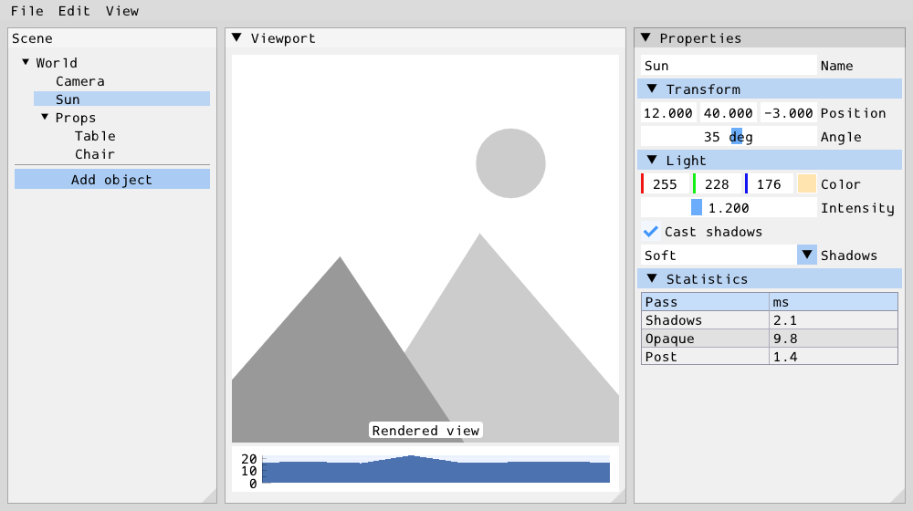

[`examples/ui_editor.yaml`](../examples/ui_editor.yaml):

```yaml
nymph: 1
description: Mockup of a 3D scene editor - a menu bar, a scene tree, a viewport and a properties panel - drawn with Dear ImGui widgets.
image: {width: 1000, height: 560, padding: 0}
data:
  frames:
    frame: [1, 2, 3, 4, 5, 6, 7, 8]
    ms: [16.4, 16.9, 15.8, 22.1, 16.2, 16.6, 17.3, 16.1]
root:
  type: Screen
  children:
    - type: MainMenuBar
      children:
        - {type: Menu, label: File, children: [{type: MenuItem, label: Open..., shortcut: Ctrl+O}]}
        - {type: Menu, label: Edit, children: [{type: MenuItem, label: Undo, shortcut: Ctrl+Z}]}
        - {type: Menu, label: View, children: [{type: MenuItem, label: Statistics, checked: true}]}
    - type: Window
      title: Scene
      x: 8
      y: 30
      width: 230
      height: 522
      flags: NoCollapse
      children:
        - type: TreeNode
          label: World
          open: true
          flags: DefaultOpen
          children:
            - {type: TreeNode, label: Camera, flags: Leaf}
            - {type: TreeNode, label: Sun, flags: Leaf|Selected}
            - type: TreeNode
              label: Props
              open: true
              children:
                - {type: TreeNode, label: Table, flags: Leaf}
                - {type: TreeNode, label: Chair, flags: Leaf}
        - {type: Separator}
        - {type: Button, label: Add object, size: [-1, 0]}
    - type: Window
      title: Viewport
      x: 246
      y: 30
      width: 440
      height: 522
      children:
        - {type: Image, image: landscape, width: -1, height: -60, fit: cover, label: "Rendered view"}
        - type: Plot
          title: Frame time
          height: 50
          flags: NoTitle|NoLegend|NoMenus
          x_flags: NoDecorations
          children:
            - {type: PlotShaded, label: ms, xs: $frames:frame, ys: $frames:ms}
    - type: Window
      title: Properties
      x: 694
      y: 30
      width: 298
      height: 522
      children:
        - {type: InputText, label: Name, value: Sun}
        - type: CollapsingHeader
          label: Transform
          open: true
          children:
            - {type: DragFloat3, label: Position, value: [12, 40, -3], speed: 0.1}
            - {type: SliderAngle, label: Angle, value: 35}
        - type: CollapsingHeader
          label: Light
          open: true
          children:
            - {type: ColorEdit3, label: Color, value: "#FFE4B0"}
            - {type: SliderFloat, label: Intensity, value: 1.2, min: 0, max: 4}
            - {type: Checkbox, label: Cast shadows, value: true}
            - {type: Combo, label: Shadows, items: [Hard, Soft, Off], selected: 1}
        - type: CollapsingHeader
          label: Statistics
          open: true
          children:
            - type: Table
              flags: Borders|RowBg
              children:
                - {type: TableColumn, label: Pass, cells: [Shadows, Opaque, Post]}
                - {type: TableColumn, label: ms, cells: ["2.1", "9.8", "1.4"]}
```

## A settings dialog

One `Window` as `root`, in the dark theme: tabs (the second selected), separators with text, a combo, sliders with formats, radio buttons on one line, a data table and an open tooltip.

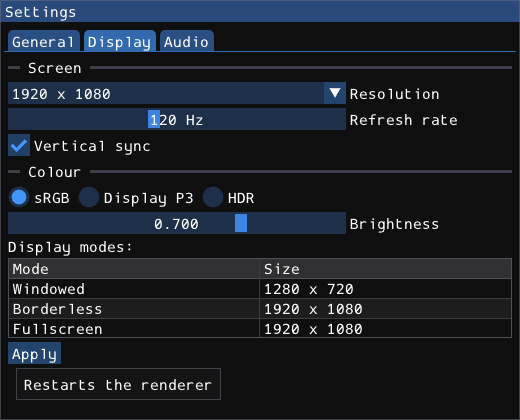

[`examples/ui_settings.yaml`](../examples/ui_settings.yaml):

```yaml
nymph: 1
description: Mockup of a settings dialog - one window with tabs, controls of every kind and a table - in the dark theme.
image: {width: 520, height: 420, theme: dark, padding: 0}
root:
  type: Window
  title: Settings
  children:
    - type: TabBar
      children:
        - {type: TabItem, label: General, children: [{type: Text, text: Not shown}]}
        - type: TabItem
          label: Display
          selected: true
          children:
            - {type: SeparatorText, label: Screen}
            - {type: Combo, label: Resolution, items: [1280 x 720, 1920 x 1080, 2560 x 1440], selected: 1}
            - {type: SliderInt, label: Refresh rate, value: 120, min: 30, max: 240, format: "%d Hz"}
            - {type: Checkbox, label: Vertical sync, value: true}
            - {type: SeparatorText, label: Colour}
            - {type: RadioButton, label: sRGB, active: true}
            - {type: SameLine}
            - {type: RadioButton, label: Display P3}
            - {type: SameLine}
            - {type: RadioButton, label: HDR}
            - {type: SliderFloat, label: Brightness, value: 0.7}
            - {type: Text, text: "Display modes:"}
            - type: Table
              flags: Borders|RowBg|SizingStretchSame
              children:
                - {type: TableColumn, label: Mode, cells: [Windowed, Borderless, Fullscreen]}
                - {type: TableColumn, label: Size, cells: [1280 x 720, 1920 x 1080, 1920 x 1080]}
            - {type: Button, label: Apply}
            - {type: Tooltip, open: true, children: [{type: Text, text: Restarts the renderer}]}
        - {type: TabItem, label: Audio, children: [{type: Text, text: Not shown}]}
```

## A UI flow

Three screens of an app and the events that lead from one to the next: `WindowTransition` arrows between windows with an `id`, side by side when two windows are linked both ways, a dashed error path and a loop.

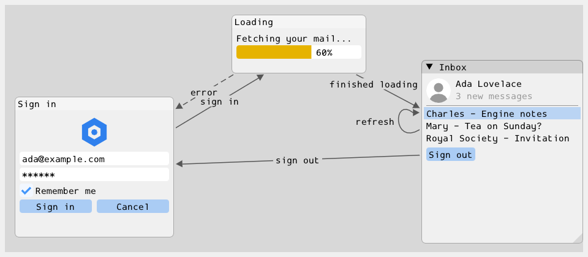

[`examples/ui_flow.yaml`](../examples/ui_flow.yaml):

```yaml
nymph: 1
description: Mockup of a mail app's sign-in flow - sign in, loading, inbox - with the events that lead from one screen to the next.
image: {width: 960, height: 420}
root:
  type: Screen
  window_rounding: 6
  frame_rounding: 4
  children:
    - type: Window
      id: sign_in
      title: Sign in
      x: 16
      y: 150
      width: 260
      height: 230
      flags: NoResize|NoCollapse
      children:
        - {type: Image, image: logo, width: -1, height: 56, background: "#00000000", tint: "#2F80ED"}
        - {type: InputTextWithHint, label: "##user", hint: Email, value: ada@example.com, width: -1}
        - {type: InputText, label: "##password", value: secret, flags: Password, width: -1}
        - {type: Checkbox, label: Remember me, value: true}
        - {type: Button, label: Sign in, size: [118, 0]}
        - {type: SameLine}
        - {type: Button, label: Cancel, size: [118, 0]}
    - type: Window
      id: loading
      title: Loading
      x: 370
      y: 16
      width: 220
      height: 96
      flags: NoResize|NoCollapse
      children:
        - {type: Text, text: Fetching your mail...}
        - {type: ProgressBar, fraction: 0.6}
    - type: Window
      id: inbox
      title: Inbox
      x: 680
      y: 90
      width: 264
      height: 300
      children:
        - type: Group
          children:
            - {type: Image, image: person, width: 40, height: 40, rounding: 20}
        - {type: SameLine}
        - type: Group
          children:
            - {type: Text, text: Ada Lovelace}
            - {type: TextDisabled, text: 3 new messages}
        - {type: Separator}
        - {type: Selectable, label: "Charles - Engine notes", selected: true}
        - {type: Selectable, label: "Mary - Tea on Sunday?"}
        - {type: Selectable, label: "Royal Society - Invitation"}
        - {type: Spacing}
        - {type: Button, label: Sign out}
    - {type: WindowTransition, from: sign_in, to: loading, label: sign in}
    - {type: WindowTransition, from: loading, to: inbox, label: finished loading}
    - {type: WindowTransition, from: loading, to: sign_in, label: error, dashed: true}
    - {type: WindowTransition, from: inbox, to: sign_in, label: sign out}
    - {type: WindowTransition, from: inbox, to: inbox, label: refresh}
```

## Placeholder images

Every built-in image `Image` and `ImageButton` can show, by name, and below them `rounding`, `tint` (with a transparent `background`), `fit: cover` and the stretching `cross`.

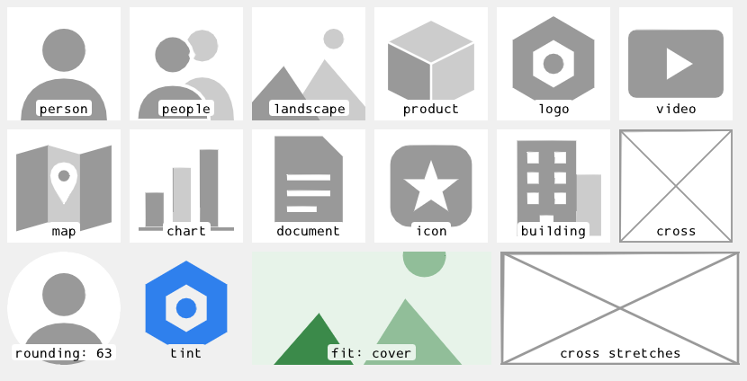

[`examples/ui_placeholders.yaml`](../examples/ui_placeholders.yaml):

```yaml
nymph: 1
description: The built-in placeholder images of Image and ImageButton, by name; the last row shows tint, background and rounding.
image: {width: 830, height: 424}
root:
  type: VerticalLayout
  spacing: 10
  children:
    - type: HorizontalLayout
      spacing: 10
      children:
        - {type: Image, image: person, width: 126, height: 126, label: person}
        - {type: Image, image: people, width: 126, height: 126, label: people}
        - {type: Image, image: landscape, width: 126, height: 126, label: landscape}
        - {type: Image, image: product, width: 126, height: 126, label: product}
        - {type: Image, image: logo, width: 126, height: 126, label: logo}
        - {type: Image, image: video, width: 126, height: 126, label: video}
    - type: HorizontalLayout
      spacing: 10
      children:
        - {type: Image, image: map, width: 126, height: 126, label: map}
        - {type: Image, image: chart, width: 126, height: 126, label: chart}
        - {type: Image, image: document, width: 126, height: 126, label: document}
        - {type: Image, image: icon, width: 126, height: 126, label: icon}
        - {type: Image, image: building, width: 126, height: 126, label: building}
        - {type: Image, image: cross, width: 126, height: 126, label: cross}
    - type: HorizontalLayout
      spacing: 10
      children:
        - {type: Image, image: person, width: 126, height: 126, rounding: 63, label: "rounding: 63"}
        - {type: Image, image: logo, width: 126, height: 126, tint: "#2F80ED", background: "#00000000", label: tint}
        - {type: Image, image: landscape, width: 266, height: 126, fit: cover, tint: "#3B8A4A", background: "#E7F3E9", label: "fit: cover"}
        - {type: Image, image: cross, width: 266, height: 126, label: "cross stretches"}
```
