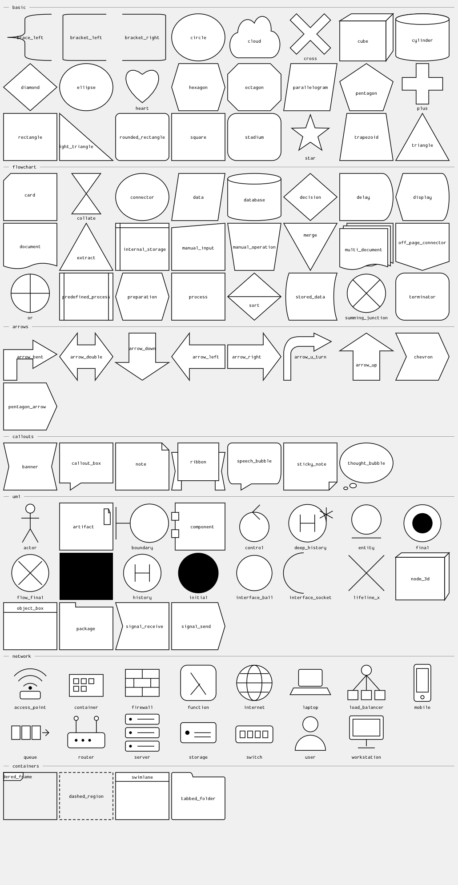

# nymph — Shape library

About 100 vector shapes ship inside nymph: boxes and polygons, flowchart symbols, arrows, callouts, UML and network icons and container frames. Use them

- as a diagram node's `shape` (`ComponentDiagram`, `DeploymentDiagram`, `PackageDiagram`, `TreeDiagram`, `OrgChart`, ...) or `symbol` (`FlowNode`),
- on their own with the `Shape` element, in a layout, for legends and annotations.

`nymph shapes` lists them (`category/name`), `nymph shapes <name>` describes one, and the MCP tool `list_shapes` does the same for agents.



Source of the image: [`shapes.yaml`](shapes.yaml).

```yaml
- {type: Shape, shape: cloud, text: Internet, fill_color: "#DCE9F7"}
- {type: Shape, shape: actor, text: User}
- {type: FlowNode, id: db, text: Orders, symbol: cylinder}
```

## How a shape behaves

- **Resizable** shapes (boxes, diamonds, arrows, callouts, frames) fill any size. Corners, caps, tabs and folded corners keep their size (a nine-patch), so a rounded rectangle has the same radius at any size. The label goes inside the shape's text area.
- **Icons** (`actor`, `server`, `router`, `user`, `final`, ...) keep their aspect ratio and the label goes below.
- Lines use the diagram's line colour and the inside its fill colour (`color` / `fill_color` of the node).

## Adding or changing a shape

A shape is an SVG file in `resources/shapes/<category>/<name>.svg`; drop one in and rebuild. Edit it in any SVG editor; the rules are in [resources/shapes/README.md](../resources/shapes/README.md). The design is in [spec/13_more_diagrams_and_shapes](../spec/13_more_diagrams_and_shapes/DESIGN.md).
